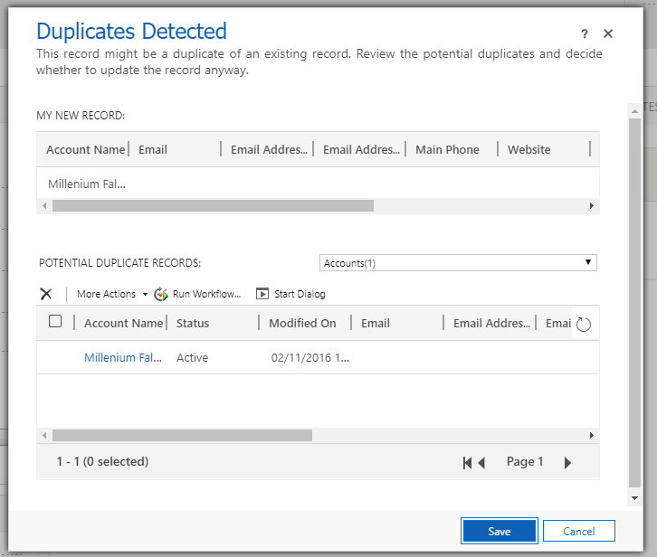
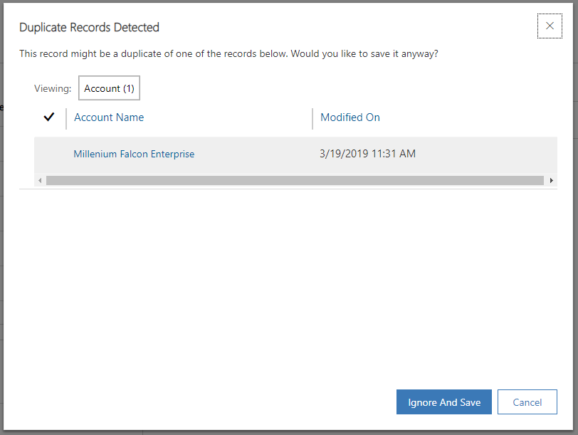
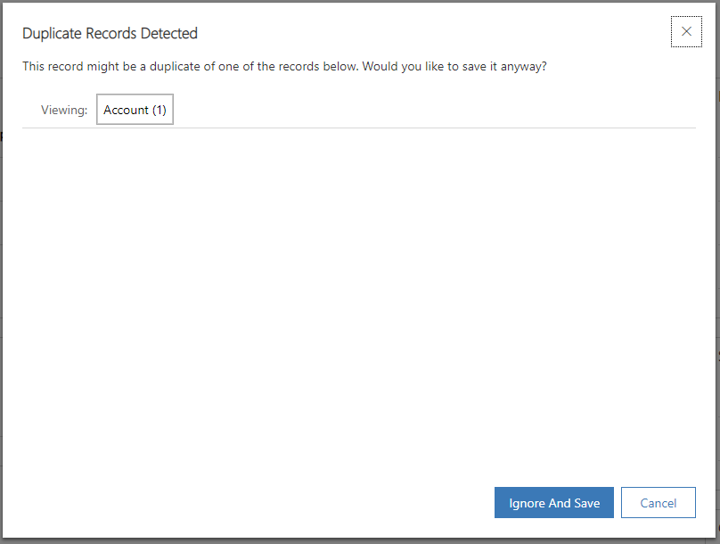
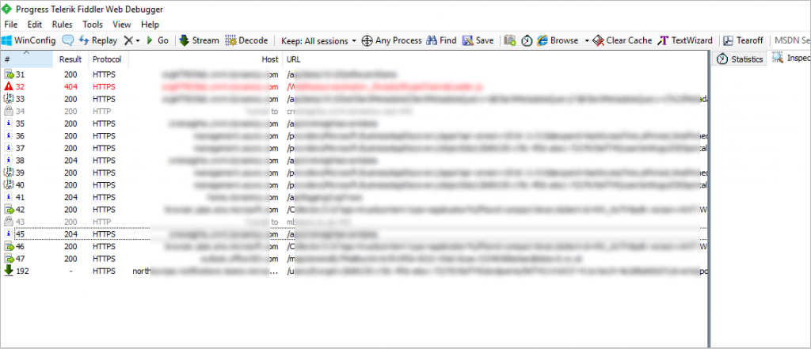

Duplicates Detected! We’ve read that sentence many times through our careers within CRM but I’ve mostly always just taken for granted that it works well. But what if it doesn’t?

I’m sure we all have seen this screen many, many times.

<figcaption>Duplicates Detected… </figcaption>

Whether we chose to make a duplicate or resolve the existing is a hot topic for a different time, the main point of this blog post is the actual finding of duplicates.

As with all technology, it moves on and Dynamics CRM is no different. With the introduction of the new Unified Interface, the duplicates detected window has had it’s first face list in over a decade, so this is now what you will see instead.

<figcaption>Duplicates Detected in the Unified Interface </figcaption>

Immediately I can see it looks different and interesting the entire section we used to get about the record you are inputting right now has disappeared! I can deal with this new window though, it’s a much neater and crisper look than the decade old legacy one.

Recently however, I started running into more complex problems. I would get the window pop up and it would give me my duplicate count, as well as which entity type it was potentially duplicated with, but that was it. It wouldn’t show me any actual details about the duplicate it found which means I was unable to make a useful decision as to whether it was a valid duplicate or not. This is what I saw.

<figcaption>Where are my duplicates?</figcaption>

At first, I thought it might be a platform version issue so I asked around the other experts I could and they hadn’t seen it – even people in the same CRM geo-location and exactly the same versions weren’t seeing these issues. Further more, I was only sometimes hitting this issue, so I decide to do some more digging as it was going to annoy me further and if I’ve experienced it, someone somewhere will at some point!

Eventually, I lucked out and accidentally made some progress! The tool that inadvertently helped my breakthrough? Fiddler!

<figcaption>Basic Fiddler Example</figcaption>

If you’ve never used Fiddler, it’s great for showing all requests made by a browser. You can use in browser features to do this stuff too, but I’ve always found Fiddler more useful due to it’s additional features such as AutoResponder and Composer. More on that in later blog posts though!

I left Fiddler running whilst playing about and I noticed an unexpected failure in the Fiddler window so I dug down a little more bit more and eventually found out what was going on!

**Duplicates Detected in the Unified Interface**  
When a duplicate is detected in the Unified Interface, it does a number of actions on save. The key things we care about happen in this order:

1.Using WebAPI, the Unified Interface attempts to save your record. The server actually responds with a 412 Error (Precondition Failed) with the following in the body: “A record was not created or updated because a duplicate of the current record already exists.”.

2. Again, using WebAPI, it then makes a request to what appears to be an undocumented SDK message called “GetEntityWideDuplicatesCount”, which passes some basic details of your entity and gives a JSON response, showing which entity types and the count of each duplicate.  <em>{“@odata.context”:”https://xxxxx.crm4.dynamics.com/api/data/v9.0/$metadata#Microsoft.Dynamics.CRM.GetEntityWiseDuplicatesCountResponse”,”DuplicatesCount”:[1],”EntityLogicalNames”:[“account”]}</em>

3\. A number of WebAPI requests then run against the metadata (the “EntityDefinitions” endpoint) seemingly so the window has some idea about the entity type a duplicate was found for.

4\. Finally – this is where I noticed the problem! A WebAPI request is made to the “RetrieveDuplicates” and this request is causing an error 500! This would explain why we are seeing the window but it’s failing at the last hurdle to actually show the duplicates on screen. The error message we get back is: “ExceptionMessage=Invalid URI: The Uri scheme is too long.” so let’s take a look at the full request URI.  
*https://xxxx.crm4.dynamics.com/api/data/v9.0/RetrieveDuplicates(BusinessEntity=@BusinessEntity,MatchingEntityName=@MatchingEntityName,PagingInfo=@PagingInfo)?@BusinessEntity=%7B%22%40odata.type%22%3A%22%23Microsoft.Dynamics.CRM.account%22%2C%22description%22%3A%22gtrgtr%5Cnbtrkjbtkltrjbl%5Cn%23btrjkhjkrhbjkh%5Cnbtjhbjerkhjkhbtr%5Cnioherjkthjkhebtrjkber%5Cnerbtjuhjerbthjktrehjklhbetrjk%22%2C%22ownershipcode%22%3A1%2C%22industrycode%22%3A2%2C%22websiteurl%22%3A%22https%3A%2F%2Fwww.mbeard.co.uk%22%2C%22fax%22%3A%220151%22%2C%22telephone1%22%3A%220151%22%2C%22name%22%3A%22Millenium%20Falcon%20Enterprise%22%2C%22creditonhold%22%3Afalse%2C%22donotpostalmail%22%3Afalse%2C%22donotfax%22%3Afalse%2C%22donotphone%22%3Afalse%2C%22donotbulkemail%22%3Afalse%2C%22followemail%22%3Atrue%2C%22donotemail%22%3Afalse%2C%22preferredcontactmethodcode%22%3A1%2C%22transactioncurrencyid%40odata.bind%22%3A%22%2Ftransactioncurrencies(c2c55855-3d41-e911-a9b4-000d3a2d5c5d)%22%2C%22statuscode%22%3A1%2C%22statecode%22%3A0%2C%22ownerid%40odata.bind%22%3A%22%2Fsystemusers(20ba8149-4b70-40ca-8b4f-cc6d008c9d92)%22%2C%22modifiedon%22%3A%221991-01-01T00%3A00%3A00.000Z%22%7D&@MatchingEntityName=%27account%27&@PagingInfo={%22Count%22:50,%22PageNumber%22:1,%22PagingCookie%22:null,%22ReturnTotalRecordCount%22:true}*

It is a long URL and I know some of the data in their is nonsensical but it’s only there as a demonstration. I don’t have any official answers for this, only my findings but it seems the “RetriveDuplicates” passes ALL the dirty fields, including those with default values such as currency through as part of the GET requests URL. This means the URL can very quickly go too long and therefore breaks!

I imagine this may get ironed out as the legacy interface actually called a different endpoint to calculate duplicates (hence why this cannot be reproduced in the legacy interface) but in the meantime, if you are getting issues try to reduce the amount of fields that are populated at the point of save. It’s not ideal but sadly, it’s all I have at this moment in time.

So frustrating problem fixed (sort’ve) – and it was interesting to see how those duplicates detected windows are actually set up!
