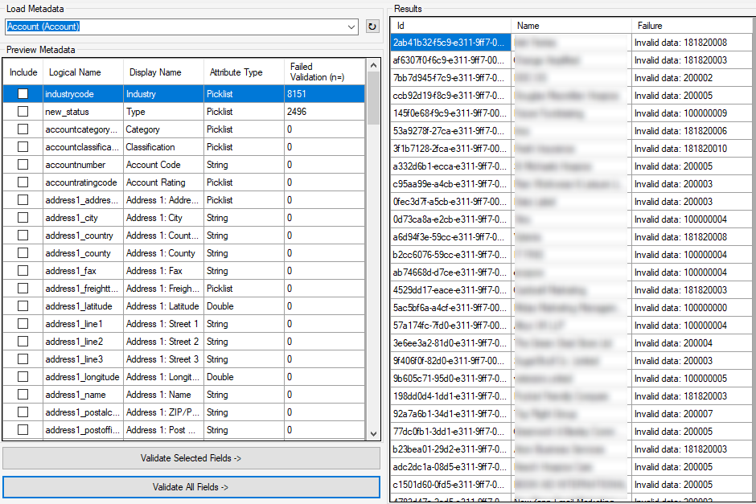

## The Data Export Validation Tool for D365

As a long time developer with an On-Premise development environment, the ability to see the SQL behind a CRM system/CE system \[.. or whatever it’s called nowadays, but for habits sake it will hear on be called CRM…\] can often be invaluable and was often the hurdle that a lot of people didn’t want to overcome in order to move to an Online environment. [The Data Export Service changed all that when it was introduced back in 2017](https://blogs.msdn.microsoft.com/crm/2017/04/11/introduction-to-dynamics-365-data-export-service/).

With some easy to follow instructions, you can have a database sitting within your Azure tenant which contains a copy of all the data you care about from your online system. It’s a great alternative and certainly ticked a lot of boxes when it was first released. Whilst doing some work with it in it’s early days, I would often hit some stumbling blocks which can be difficult to overcome and I always told myself I’d do something to make the pain easier – today is that day!

Changing metadata within CRM isn’t difficult to do. When you first create a new field, you may just set it to a random limit such as 100 characters. Over time, you forget why that limit is in place and something occurs which makes you decide to reduce the 100 characters down to a lower amount, say 80 characters. The system will have no issue with that and from here on out, 80 is your limit – but what about the old data? If something was previously over 80 characters, is it still there? The answer is yes. It’s still there without a problem so whats the issue?

If you then decide to open a record that has over 80 characters in that field, make a update to the record and try to save then the validation will kick in – preventing your save and forcing you to manually truncate that data. Far from ideal. If you’re a developer doing this through code, the SDK will throw an exception and prevent it too (although it’s a little easier to fix in code – just remove the attribute from the attribute collection from the entity you are updating).

But this is about the Data Export Service you said? Well it is. The service automatically builds the data structure in your SQL database at the start and then starts syncing your data. The issue comes in when it builds the data structure. I suspect that the Data Export Service loads all the metadata in directly from your CRM and builds a SQL Create Table statement using that metadata – which means in the scenario above, it would make a nvarchar column of 80 characters. Once the table is made, it starts to sync the data across but rather unsurprisingly, a text string of 100 characters cannot be stored in a column of 80 characters – Data Export Service sync fail!

So finally, introducing the **Data Export Validation Tool**.

The Data Export Validation Tool uses the XrmToolBox and does these simple yet effective steps:

1.  Connect to your organization through the fantastic XrmToolBox
2.  Allow you to select an entity type, before listing all fields for that entity type.
3.  Allow you to select which fields you care about (or a button to check all)
4.  Validates the data stored within each record and field against the metadata.

After processed all records of that entity type, you will be given some results and told if and why validation failed. A list of records will also be provided and each record will have an invalid reason.

Whilst we are checking for the issues around data truncation, we can use this time to validate other fields – these won’t necessarily cause the Data Export Service to fail but they would highlight you have data that may not be fit for purpose and isn’t adhering to your metadata. What this means is the Data Export Validation Tool will check the following:

**Text Fields** – As described, is a field too long?  
**Number Fields** – Number fields are checked to see if the number saved in the field is above or below the minimum/maximum values specified in the metadata.  
**Option Sets** – Option Set fields are checked against the possible option set values to see if the option set value is still valid.

<figcaption>An example of a completed check against accounts </figcaption>

You can see in this example image that my data has failed validation on two fields – both of which are picklist fields. This means that over time, the choices within the picklists have changed but the data was never updated and managed properly at that point, meaning that data is now essentially lost and we will never know what the original value was.

This is my first public XrmToolBox tool and it’s on [GitHub](https://github.com/mattybeard/DataExportValidationChecker). I have plenty more things to add to it but I wanted to share my first version with the world in the hope it saves somebody a headache at some point.

Just wanted to take this time to thank Jonas Rapp ([@rappen](https://twitter.com/rappen)). Whilst I’d delved a little into XrmToolBox tools, he gave a great session at a D365 Saturday event in Glasgow which inspired me to take an extra step. He even generously helped out a little with the WinForms element of this tool as I’ll be the first to admit it isn’t my strong point!

If you have any thoughts, comments or suggestions then grab me on Twitter – I tweet far too much. You can find me [@mattybeard](https://twitter.com/mattybeard).

Thanks for taking the time to read.

Matt
