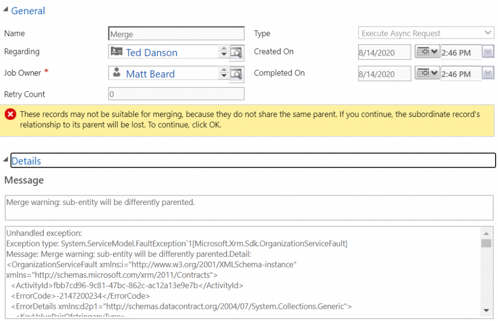

In recent updates, the default behaviour for merging meant it moved to an async action ([https://docs.microsoft.com/en-us/power-platform/admin/async-cascading](https://docs.microsoft.com/en-us/power-platform/admin/async-cascading)). The main UI hasn’t really changed but by moving async, there is some significant changes in the UX and it isn’t near as intuitive as it used to be. What makes it worse is depending on what you’re trying to merge, sometimes it’s just broken and you simply cannot merge.

*“These records may not be suitable for merging, because they do not share the same parent. If you continue, the subordinate record’s relationship to its parent will be lost. To continue, click OK.”*

<figcaption>The new error in merging</figcaption>

I spend a lot of time in the intricacies of merging and duplicate detection as I’m one of the creators of the [Data8 Duplicare tool](https://www.data-8.co.uk/duplicare/) – which fixes a lot of things from the long neglected area of dedupe and merge and this puts me in a strong position, alongside my colleague [Mark Carrington](https://markcarrington.dev/), to delve into what’s going on and what’s changed. We released [this blog post today](https://www.data-8.co.uk/blog/posts/2020/august/d365-asynchronous-merging/) but I’ll also touch on elements of it here.

Ultimately, all the problems people are now experiencing stem from a single parameter in the merge – `PerformParentingChecks` [(docs)](https://docs.microsoft.com/en-us/dotnet/api/microsoft.crm.sdk.messages.mergerequest.performparentingchecks?view=dynamics-general-ce-9). The reason for this is the UX has subtly changed and you used to see a warning – warning that you would potentially be re-parenting a record. I’ve seen 1000’s of people use the merging UI and the vast majority just click through it – but what this is doing is telling the system to set this value to `false`.

<figcaption>Failed system job</figcaption>

The problem is the UX completes as if the merge completed successfully and the end user, who is used to it just “working” would assume it’s worked this time – when it fact it hasn’t worked and the record still lives!

Thankfully, this understanding and the fact I’m a C# developer means the problem is relatively easy to fix. I’m fully expecting Microsoft to fix this sooner rather than later but a quick fix in the mean time is still worth it to those that use the merging functionality regularly. This won’t revert the merging back to sync but it will stop those failures that people have began to see.

I’ve turned the fix into a solution you can install – which you can [download here](https://github.com/mattybeard/CDSFixMergePlugin/releases/download/release/FixMergePlugin_1_0_0_0_managed.zip). If you want to know what is actually going on, the code is [open source and is on GitHub](https://github.com/mattybeard/CDSFixMergePlugin) – I understand people will want to know what they are installing into their system so the source code is available for those who want to install it that way.

Remember using this plugin will ALWAYS ignore parenting check, without the warning. Please understand what you’re installing – I cannot be liable for erroneous merges!

<figcaption>Successful merge</figcaption>

The main merging functionality is still very limited and the Data8 team and I have spent years perfecting the experience. If you’d like to hear more about that tool, feel free to reach out to me directly on [LinkedIn](https://www.linkedin.com/in/mattbeard7/).
