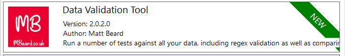
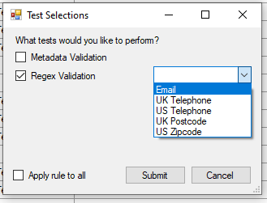

> Data Export Validation Tool for D365 CDS.

<figcaption>The new Data Validation Tool</figcaption>

A lot has changed in the world of the Power Platform [since this blog post](/blog/2019-04-01/) and that’s without even mentioned product name changes. Over a year ago, I launched the Data Export Validation Tool as I was playing with Data Export Service and it kept breaking – but now the technology has moved on, the names have changed so it’s time for a rebrand and a new 2.0 launch!

The Data Validation Tool for CDS is a fresher way of validating the data in your system, en masse but even better, you can now validate the data in a few ways.

By selecting a row, you can double click the “Tests” column and select which test you would like to run against that field.

<figcaption>New test selection screen</figcaption>

**Metadata Tests**

This is the same as 1.0 of the tool – we will take the stored metadata of a field and check it against the actual field values. The original blog post contains lots of information as to why that isn’t as pointless as it may sound so please go and check it out, although ignore the now out of date screenshots

**Regex Tests**

Now you can select a number of pre-defined regexs to get a generic idea about the quality of your data. You can use email, UK phone, US phone, UK postal code and US zip code at this time but if there is anything you’d like to see, please reach out on [Twitter](https://www.twitter.com/mattybeard). It’s worth mentioning a few things at this point – I work with data quality every single day for Data8 and in general, regex isn’t the saviour. There are much better options available that will actually check the [phone network, email network, addressing network](https://appsource.microsoft.com/en-gb/?search=data8) and give you more accurate results BUT regex is good enough as a start point to get an idea of just how bad your data is.

I rewrote most of the tool from the ground up, meaning the option to add more tests in over time should be relatively simple so there will be more tests adding in the coming months. I’m also hoping to hook into SQL4CDS by Mark Carrington to enable you to fix this poor data quality immediately right inside XrmToolBox but I’ll talk more about that when it’s ready to go.

This project is open source and you can see the code [here](https://github.com/mattybeard/DataExportValidationChecker) – if you have an issue, either reach out directly or chuck an issue on Github and I’ll pick it up.
