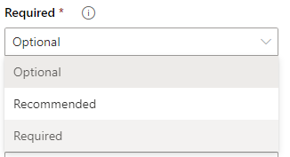
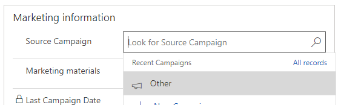

It’s a bold statement I know but hear me out and I’ll try and help you see why I believe this. I will make a few generalisations throughout and I know the answer to how applicable a lot of this is “…it depends” but I’m positive at least some elements of this will resonate with you.

<figcaption>Setting a field as required</figcaption>

Required fields will, at some point, detract from the quality of your data in pretty much any system. By how much depends on the metadata of the field as well as the ultimate aim trying to be achieved.

To over simplify a system, there are 3 types of data you can put into a text field.  
**1) Helping text** i.e. description on account. The data in this field is for someone else to read – it could be a mix of facts or opinions. This type of data is very rarely used for analysis.  
**2) An opinion or a guess** i.e. probably on “opportunity”. The data is this field is open to the users interpretation and cannot be confirmed.  
**3) A fact** i.e. a telephone number on “contact”. The data in this field is either right or wrong.

Let’s go through each one.

**Helping text**. This isn’t a field type that really affects data quality as it just sits there to help others but let’s thinks about the remaining two and what happens if you make them required fields.

**Opinion fields.** I can understand the requirement to make these required and I would have no problems suggesting you doing just that – but what I would suggest is document the decisions users must make when deciding the value of the field. As it’s down to an individual users interpretation you will end up with natural inconsistency throughout your system and if you can do anything to assist those users in making more consistent choices throughout, it will make it easily in the long run if you wish to analyse. Many times have I heard statements like “User XYZ is much better at converting the hard opportunities” when all it really means is User XYZ isn’t very good at managing his sales pipeline.

**Factual fields.** This is there I have a real issue with required fields. No matter how much you think “We will always have a phone number for a contact”, the simple fact is you won’t. So if you set phone number fields to be required, then what happens? Normally something like this:

<figcaption>0 is definitely not a phone number</figcaption>

“We will always have either a phone number or an email address”. Fair enough point and if you’re a digital business then you’re probably correct but that doesn’t mean you make them required as you aren’t guaranteed to have both, which means one could be full of junk! If and only if you are 100% guaranteed to have valid data for a field then you can make it required, otherwise I would suggest thinking of alternatives, which I will go through in my next blog post.

**What about non-text fields?**

As long as you can maintain whatever source populates a non-text field whether it’s an option set or a lookup, as long as it’s well maintained then required fields are good to go – but again, think bigger picture. Source campaign is a fantastic example here.

Your list of campaigns is in great shape and well maintained by your marketing team. Your monthly reports showing you what campaign your closed opportunities came from is working great but at some point, a user of your system makes a new campaign because his new lead doesn’t quite fit any other campaign criteria and he’s realised he has create permissions on the campaign entity. He calls the campaign “Other”. Other users notice firstly stumble the “Other” campaign because have their permissions set to read all campaigns – but this now makes that campaign the last used so is now quickly accessible so it becomes a go to – most users will, whether they realise it or not, use the path of least resistance when filling in required fields and within a short period of time, hard work can be undone.

Please join me for part 2 of this post in a few days – I haven’t quite finished my evidence yet but wanted to take a pause for a short while for you to digest. I’ve also got comments enabled on the blog so I’d be curious of any thoughts or comments readers may have which I will respond to in part 2.
