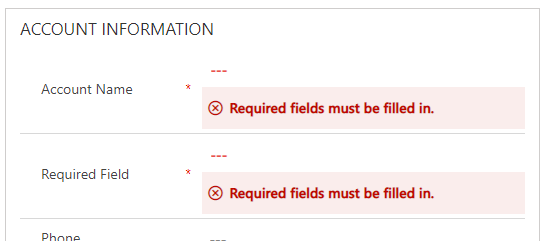
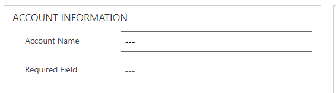
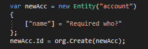

Thank you for coming to my follow up for why I think required fields are over-rated! [If you missed part 1, you can catch it here.](/blog/2020-09-07/) Last time I spoke about the different types of fields and the data they contain so this post will start off a little technical.

Ultimately, required fields are only enforced client side. Huh? What does that mean? Your users are the client, using a web client, which means it’s their web browser that is ultimately telling them that a field isn’t required – so when they press “Save” and send the data to the server to be saved, the server just assumes whatever it get is correct and will save it.

So, let’s look at an example form, with a required field that I’ve called “Required Field”. This has been set up like normal as a system required field, meaning you can be confident that field is always populated right?

<figcaption>Required fields must be filled in</figcaption>

I’m a developer so I have a little secret advantage – I have a better understanding of the internet and I know how a web browser works in a little more detail than the average user. I have an even bigger advantage as I’m a developer with an interesting in model driven apps which means I know this exists – [setRequiredLevel](https://docs.microsoft.com/en-us/powerapps/developer/model-driven-apps/clientapi/reference/attributes/setrequiredlevel).

The required behaviour done by the client is actually done when the page loads – which means it can be undone with a little bit of custom code and a single line of code is enough to ruin your required assumptions.

`formContext.getAttribute(arg).setRequiredLevel('none');`

As a developer I often use an amazing tool called “[Level Up for Dynamics 365](https://chrome.google.com/webstore/detail/level-up-for-dynamics-365/bjnkkhimoaclnddigpphpgkfgeggokam?hl=en)” which packages a whole host of these powerful things up into a Chrome plugin – one of which is the ability to remove all required settings from a field. The biggest problem? You simply have no way of stopping it in the client – as long as a user has write access to the entity, they can ignore your required setting if they felt like being malicious.

<figcaption>No longer required…</figcaption>

At this time, it’s also worth adding that because we are still talking client side enforcement, any other route your data may take is also open to abuse.

<figcaption>C# console app doesn’t care</figcaption>

This is a super small snippet of a C# console application and guess what? It doesn’t care that the required field isn’t populated. Neither will any other integration or method of data importing like the data import wizard.

So I have quickly overruled the “required” element of a field in more than one way – none of which my normal day to day users will even realise about and it then means your system manager will be getting queries from people who want that required fields saying “This field is required but isn’t filled in. Why?” and then people will start pointing the finger and possible creating issues down stream with the data. Once again, required fields are potentially causing more problems than they are solving.

I have one more argument to make in another post that will be out shortly – then we will see what we can actually do about it as an issue and work out viable approaches to make it work like you want it to.
