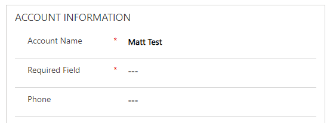
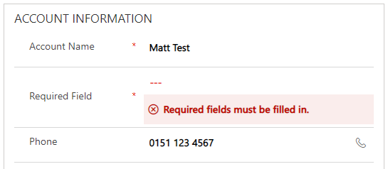
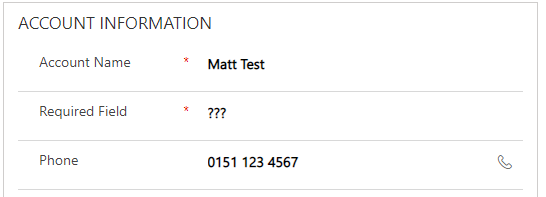

I’ll be honest when I started writing about required fields, I didn’t expect to still be writing at part 3 but here we are – shows I have a lot of thoughts about them! Part 1 is [here](/blog/2020-09-07/) and part 2 is [here](/blog/2020-09-10/).

Previously we have spoken about using required fields from the very start – when a system is first created and decisions are made about fields and which ones should be required. Problem is, systems and requirements change – have you ever heard this conversation?

`Can we change our form and make this additional field required as well because we need to start using it in reporting?`

I understand that people will want a field to become required because they have been tasked with something that is heavily reliant on that field but is that the correct decision? Generally I’m going to say no – making this field required will be detrimental to your system for more reasons than you might initially realise. Take this example:

My account entity is simple – the “Account Name” field is the only one required across the whole entity and my system has been used regularly for a period of time until I get a new requirement, please make the “Required Field” as system required because each week, the marketing team are going to run a report based on that field. Instantly, all my accounts now look like this:

<figcaption>Making a new field required</figcaption>

My users are told of this change but they instantly forget because let’s be honest, most users would and would rely on the system to remind you. The owner of the Matt Test account takes a phone call and get’s a brand new phone number for that account so like the good user they are, they input the phone number before pressing save.

<figcaption>Newly required field requires population</figcaption>

The new phone number cannot be saved as the system wants the newly required field to be populated but the problem is the user doesn’t know what to put in that field. They either don’t have the information available or simply are unaware of the change and don’t know what the purpose of that field is (particularly if it’s a free text field), so what are the choices now? 1) Discard the changes and don’t save the new number because the system won’t let you. 2) Guess what should go into the Required Field of if the data is impossible to know, just put anything in to get around this so you end up with your record looking like this

<figcaption>A example of great data quality</figcaption>

By adding a new required field in you’ve made your system harder to use and made it easier to justify users inputting poor data quality. In this example, you would have better data quality if you hadn’t made the change!

So, my closing argument is simple. If you do care about required fields and making fields be useful, populated with sensible data and be fully populated throughout the system then ironically, the out of the box “System Required” required fields option is not the best way to achieve that.

The next post is one idea of some alternative approaches you could take to achieve what you want without a detriment to others but for now, that’s enough of why you shouldn’t use them.
