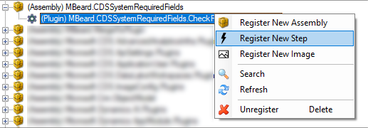
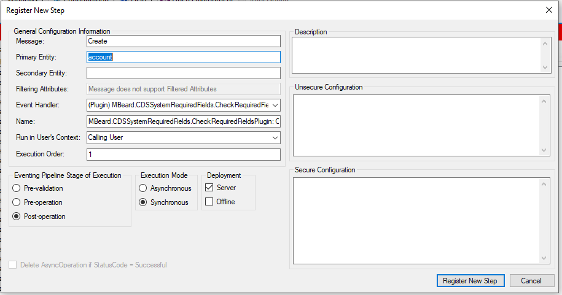

During the wrapping up of my [required fields](/blog/tag/required-fields/) series, I wrote a custom plugin to solve the problem that CDS simply doesn’t solve in a safe way – I’ve open sourced that code if you decide you would also like to use it.

The raw code can be found on [github here](https://github.com/mattybeard/CDS_SystemRequiredFields) and the [solution](https://github.com/mattybeard/CDS_SystemRequiredFields/releases/download/1.0.0.0/MBeardCDS_SystemRequiredFields_1_0_0_0_managed.zip) can be found here. This guide will assume you have installed the solution and will explain how to set up the steps.

**How to configure the solution**

1.  Boot up [XrmToolBox](https://www.xrmtoolbox.com/). If you haven’t heard of XrmToolBox – check it out then track back to me once you’re done!
2.  Get the “Plugin Registration” tool from the library if you don’t already have it and open it – connecting to your org instance at the same time.

<figcaption>Plugin Registration</figcaption>

3\. In your list of plugins, somewhere you will see `MBeard.CDSSystemRequiredFields` listed. Find it and click the “+” icon to expand.  
4\. Right click on the (Plugin) line and click “Register New Step”

<figcaption>Registering a new plugin step</figcaption>

5\. Set the follow pieces of data.

<pre>Message: "Create"
Primary Entity: "account" (or whichever entity)
Eventing Pipeline Stage of Execution: "Pre-validation".</pre>

<figcaption>An example plugin step</figcaption>

6\. Click “Register New Step”. Rinse and repeat for any other entity type.

You’re done – give it a go. Try and save a record with a missing required field and you should see the error message.

> **All code is open source and I take no responsibilities for any third party solutions you install in your system.**
