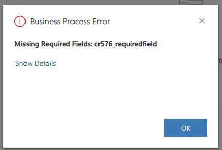
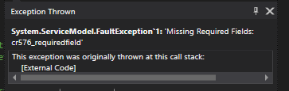
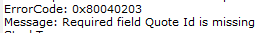
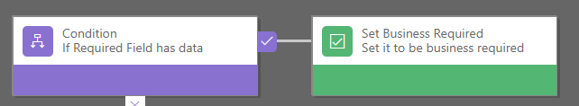
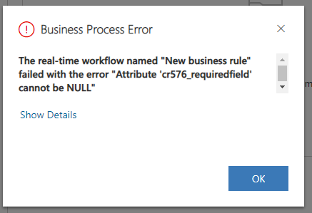
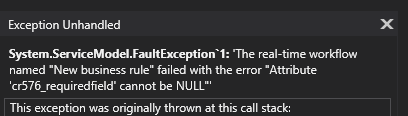

4 parts! A 4 part blog post about required fields. Who knew that was possible?! In case you missed previous, here’s [part 1](/blog/2020-09-07/), [part 2](/blog/2020-09-10/) and [part 3](/blog/2020-09-16/).

For 3 posts, I’ve spoken about why required fields can be bad and why the phrase “System Required” can be misleading depending on your users and the path the data takes into your system so let’s change pace and talk about what you can do.

In the low code no code world we currently live in, read on carefully because realistically the only way to make something truly required is with some code. Whilst I know code isn’t the only option, it’s the only real scalable option but in the interest of fairness, I’ll still talk about a low code alternative.

**Plugin with custom code**

Thankfully, doing it through custom code isn’t tricky if you’re a developer and in fact, I’ve got an [open source repo](https://github.com/mattybeard/CDS_SystemRequiredFields) and [solution](https://github.com/mattybeard/CDS_SystemRequiredFields/releases/download/1.0.0.0/MBeardCDS_SystemRequiredFields_1_0_0_0_managed.zip) that does exactly that if you’re interested – more on how to set that up on an [addendum blog post with a how to guide.](/blog/2020-09-18-2/)

By using a plugin, you can edit the pipeline and intercept any message, from any source and stop records being saved regardless of where you are. Your code can even load in metadata each time it runs, meaning it will always check for the the latest fields to be required if you do decide to change them at a later date.

Sadly the user experience of a plugin throwing an error isn’t great but it should at least get the message across to your users – this is how the example solution mentioned earlier looks.

<figcaption>Enforcing required fields</figcaption>

Importantly though, there is no way of getting around it so if you are adamant a field MUST be required this will enforce is moving forward. In post 2, I showed a C# program that made a record. If I run that same program now, I get the exact same error.

<figcaption>A consistent error message</figcaption>

Interestingly, in the core system there are situations where Dynamics 365 needs fields to be required and it HAS to be enforced. Guess how Microsoft do it? That’s right in – in a plugin!

**Business Rules**

Business rules are a low code no code approach to this and will run like a real time workflow of old as at the time of writing, real time workflows still are required to be done on the old interface and there isn’t a modern replacement in Power Automate. I have no doubt it’s on it’s way but for now, this is what we have.

We can use a new business rule to perform the same checks and cause the saving to throw itself in the event a criteria isn’t satisfied – although compared to the plugins, this will work at the start but can take some time to set up and also a lot of time to manage moving forward. This is an example business rule.

<figcaption>Business rules to save the day</figcaption>

By resetting Business Required, I can trigger a useful warning:

<figcaption>Response stopping me saving on the UI</figcaption>

Success – I can’t work around this now in the user interface and what’s better even my code gets the same error when I try to make the record.

<figcaption>Response stopping me saving in code</figcaption>

My issue with those low code approach is the scalability and the steps required. Not only do you have “System Required” set at the attribute level, you need to add those steps into the business rules for every single field and moving forward if you make a new field required, you have to do the same steps again – if you forget? You’ve made a data quality leak again.

**In Summary**

To summarise, if you really really want to use required fields and want to enforce them everywhere you possibly can then the no code/low code world needs to wait a little longer as I think a plugin will be required to do this is the most efficient and secure way.

If you have any other ideas or options for handling required fields, I’d love to hear about them!
