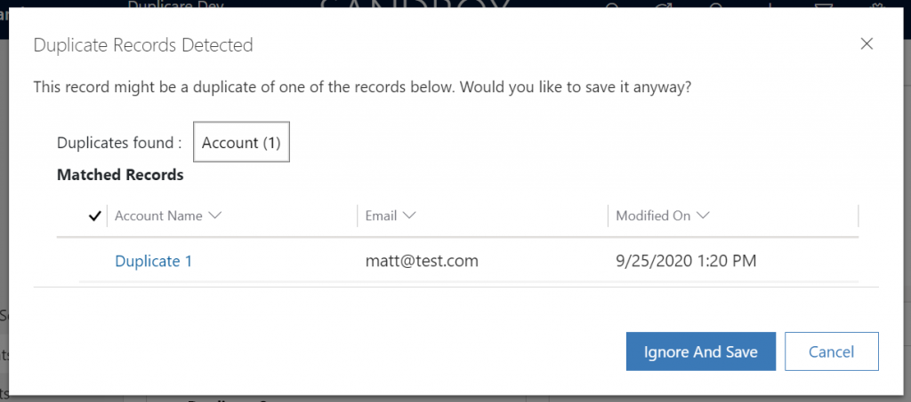
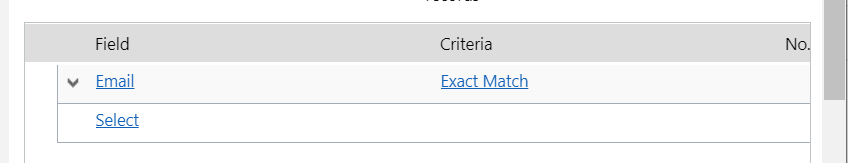
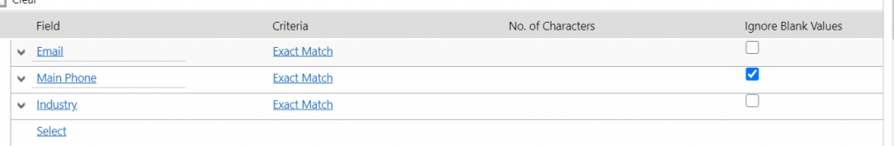
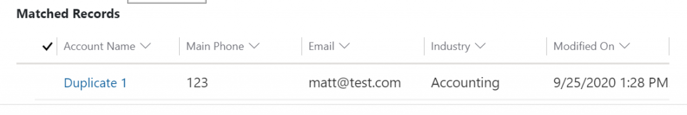
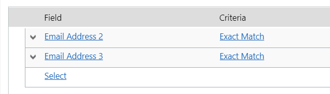
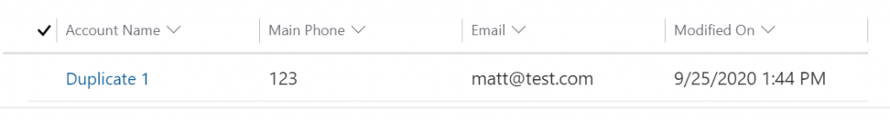
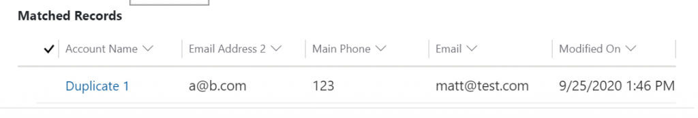
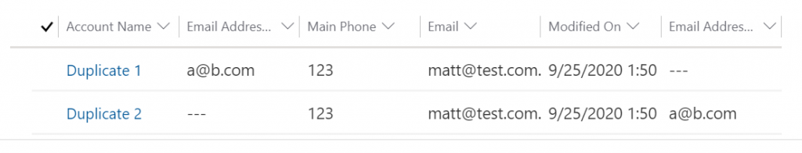

Having spent a long time specialising in the duplicates and merge area of model driven apps, this is probably one of the most asked questions I’m asked that most people respond with something like “I never knew that”, or “I didn’t see that anywhere in the docs” so I figured I’d actually take the time to write the post as my buddy [Matt Collins-Jones](https://www.d365geek.co.uk/) asked me the same question!

Almost everyone who has played in model driven apps has seen the “Duplicates Detected” both, regardless on if they meant to or not, but how exactly do you pick which fields to show on it?

First thing to note: I can’t see this anywhere in documentation. All my blog post is based on is solely my own findings and experiments so if you know more, I’d genuinely love to know.

Second thing to note: This behaviour changed between UCI and the legacy interface and this blog post will focus on the UCI as at this moment in time so I am sorry to all the on-prem folks, I do feel your pain.

<figcaption>Duplicates Detected</figcaption>

From my initial findings, the fields you see in this grid as simply as follows:

-   The Primary Name Attribute of the entity (so in account it’s “Account Name”)
-   All the fields from the published duplicate detection rules for that entity that are populated on at least one of the potential duplicate records.
-   The modifiedon timestamp.

NOTE: This does NOT include lookups or multi select picklists. I’ve not found a way of making it work for those field types at all.

That’s it – so in the example above, I have a single duplicate detection rule based on email as you see here:

<figcaption>Email duplicate detection rule</figcaption>

To prove my theory, let’s add two more fields in and see the results.

<figcaption>Updated the rule to include Main Phone and Industry</figcaption>

In this case, I added Main Phone and Industry and the results?

<figcaption>Success!</figcaption>

Now this does pose a number of issues – technically the answer to “Can you change the fields?” is “Yes” but it’s not as straight forward. You can change BUT only in a very specific way.

Now is where we add the confusion in, if I refer you back to what I said earlier

> All the fields from the published duplicate detection rules for that entity that are populated on at least one of the potential duplicate records
> 
> Matt Beard, about 30 seconds ago.

…that are populated on at least one of the potential duplicate records… What does that mean? I’m going to keep my previous “email” and “main phone” rule as is but I’m now going to make another rule.

<figcaption>Rule number 2</figcaption>

Realistically, this rule is useless but I want to use it to add more data to my duplicates detected view so let’s save and publish and try again.

<figcaption>No change 🙁</figcaption>

Email address 2 and 3 are NOT populated on the existing record so they don’t even render on the view even though I did input it on my dirty record so that shows the decision on what fields to show here solely comes from existing records and not dirty ones so let’s go back and manipulate the data to prove it. Firstly, I’ll update just email 2 on the existing record before trying again.

<figcaption>Email address 2 is now visible</figcaption>

Final test is I’m going to save a second record with email address 3 populated and as long as this record is a potential duplicate based on my “email” and “main phone” rule, email address 3 should show too.

<figcaption>Email address 3 is now visible</figcaption>

So, that’s the findings and it’s super confusing to remember that at least one of the potential duplicates must have that field populated in order for that view to show it – it certainly explains the confusion people experience over how fields seem to randomly appear and disappear from this view. It’s also worth noting at this time that in each of my screenshots, the field order is potentially different – and I’ve not yet found a way to enforce the field order.

My takeaway? You can customise and try to help but if you’re expecting something as easy as just making a new saved view, I hate to be the bearer of bad news!
