I have a pretty good idea of what Project Oakdale is and how it’s a good stop gap between D365/CDS and SharePoint lists. I can see the benefit of it for smaller internal things between Teams too so I thought whilst it’s still very new and in preview that I would have a play with it and see if it was as much of a low code, no code platform as it’s being touted as.

If you don’t know what Project Oakdale is, this is the [official link](https://docs.microsoft.com/en-us/power-platform/admin/about-teams-environment) but in a nutshell, it’s most of the Power Platform living and only accessible within Teams, so let’s boot up Teams and take a look. I have read the documentation on the link above but that’s pretty much all I’ve done, so I’m clicking, learning and blogging all at the same time!

Firstly, I’ve made a new team so I don’t affect anyone or anything and I can quickly delete without risking anyways so I’ve got a Team which consists just of me called “ProjectOakdale Testing”.

[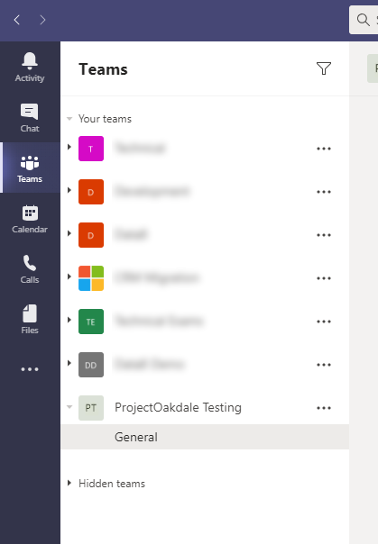](images/image-17.png)

Now what do I do? After left clicking around, right clicking in other places I eventually realised install the [Power Apps app for Teams](https://docs.microsoft.com/en-us/powerapps/teams/install-personal-app) and now I’m rolling!

[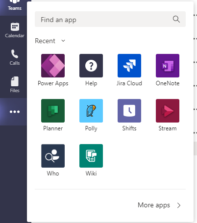](images/image-18.png)

Now I’m in Power Apps, I see a fancy new screen (alongside a large “(Preview)” comment giving me a gentle reminder). There are a bunch of useful links and tips on how to get started if you’re entirely new but seeing as I have some experience, let’s dive straight in by clicking “Create an app” on right in the middle.

I pick which Team this is going in and press “Create”. Before I pressed create though, I did notice a warning at the top which I think translates to “we will make your Project Oakdale environment for you too.”.

<pre><code>You're the first person to create an app in this team. We'll need to do some setting up, so loading time will be a little longer than usual.</code></pre>

Click “Create” and let’s get excited!

[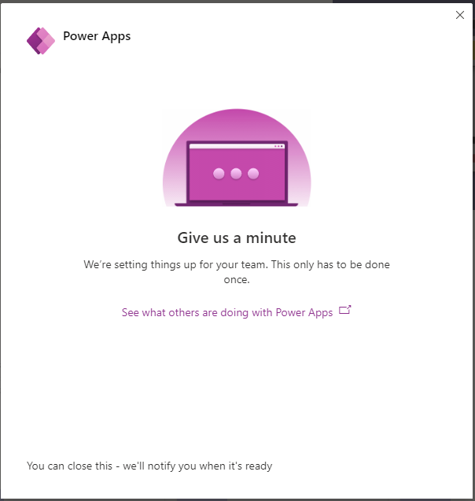](images/image-5.png)

Time for a cup of tea – it does say it’ll notify me when ready so I’m save to leave it and lo and behold, mid brew I get an email so now it’s time play!

[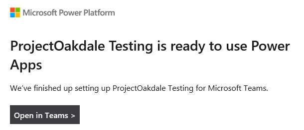](images/image-6.png)

Back to my desktop and I go back to Teams and last thing I had done was “Create an app” and it wasn’t kidding, as this is what I’m greeted with!

[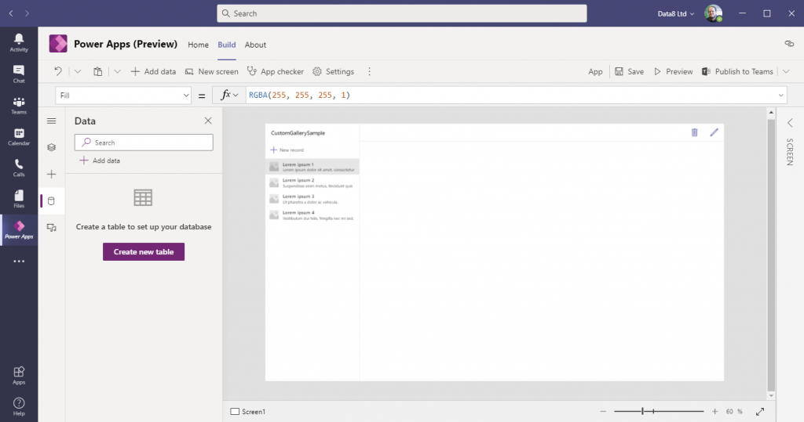](images/image-19.png)

Now what do I do?!

This is where my model driven world that stems back from Dynamics CRM 2011 takes over but I don’t see any familiar words but I’ve quickly learned one thing which means I need to do a global replace in my head!

## Entity -> Table.

Let’s start by making some data and click “Create new table” and it’s already got an example which I’m going to use, “Contact”.

Now I need to make my table. This feels super simple – it’s a nice mixture of CDS/D365, Excel, MSSQL, Power Query and all those all places where we can do things with data.

I can make columns of lots of data types so that seems like a good thing to go through in the future but for now, this is the full list.

[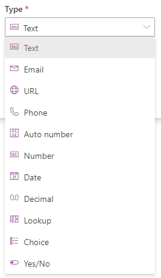](images/image-9.png)

<figcaption>Project Oakdale data types</figcaption>

This all feels very CDS’esque (that’s hard to say out loud) which lines up with how it was promoted but it’s nice to see it in practice. You can even re-order the table which for me is AMAZING and I love seeing columns in the same order. Now I have a sample data model.

[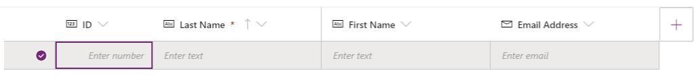](images/image-10.png)

I also want to add data in and again, I LOVE this UI how I can edit the columns and rows at the same time, that’s beautiful.

[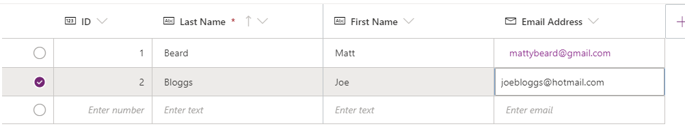](images/image-11.png)

The top of right of the page already says “Saved” so it’s also autosaving so I close that grid and again, my canvas app has already updated.

[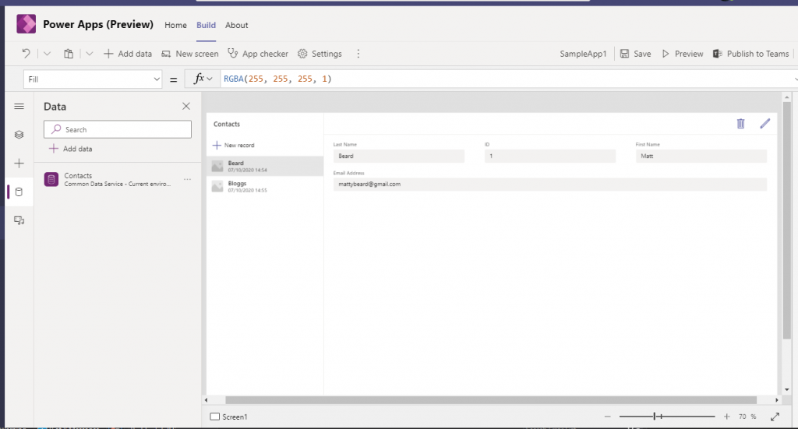](images/image-20.png)

Just like that, I have a data source on the left pane and within the app I have an edit grid on the right and record selection on the left. It’s all done for me already and I’ve barely done anything. I’ll give the app a name in the top right and save it before publishing straight away to see how it looks.

[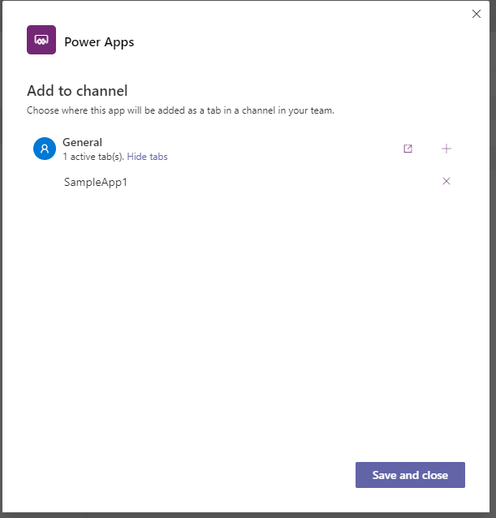](images/image-14.png)

I like to add the app as a tab to the general channel right now, so let’s do that and navigate over the tab.

[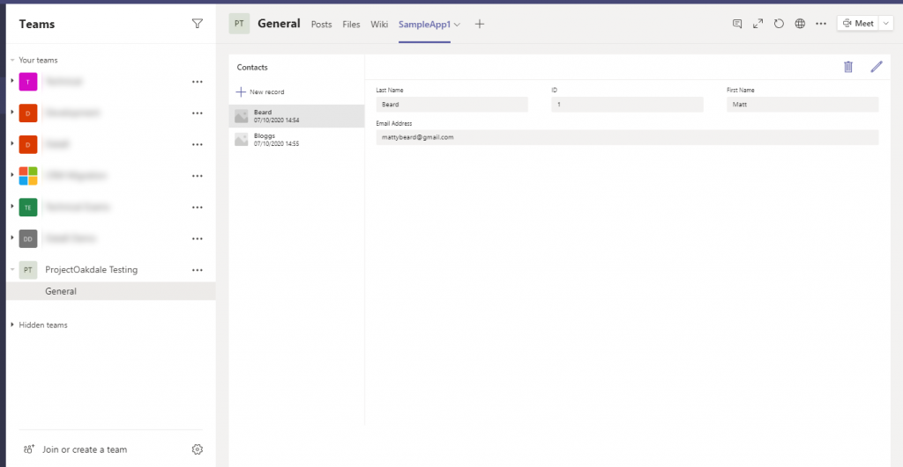](images/image-21.png)

I have a working app!

Honestly, that’s incredible. I have followed no guides and simply followed my intuition and I have a custom app, storing data somewhere directly embedded within Teams within minutes.

I’m super excited where this goes but if it stays as simple and effective as this, Project Oakdale could have some fantastic use cases.
