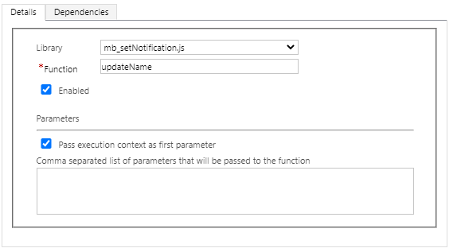
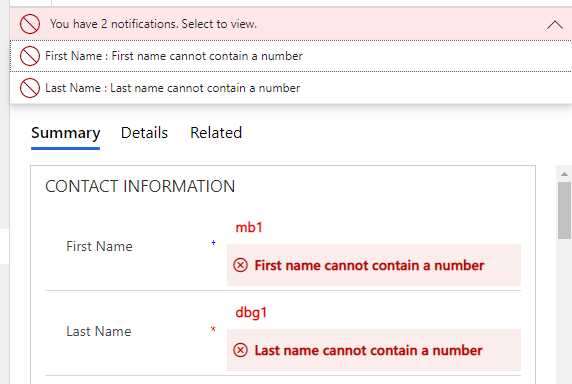
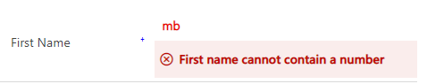
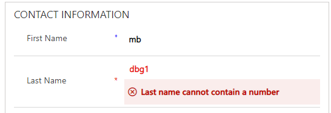

There are some fantastic parts of the model driven app world that are underused and I’m not really sure why? Maybe the fact they require coders to write them but who really knows?

Over the course of a few blog posts, I’m going to show you some of my favourite things that people don’t use enough of and they are, in part, a follow on from my previous series about required fields.

Today we are going to be talking about [setNotification](https://docs.microsoft.com/en-us/powerapps/developer/model-driven-apps/clientapi/reference/controls/setnotification).

> formContext.getControl(arg).setNotification(message,uniqueId);
> 
> A simple line of code with so much power

If you know what setNotification is and you’re screaming addNotification to me – I know, that’s going to be the next post but I wanted to start simply!

Using the power of javascript, we can do pretty much anything we want to (that is supported…) and if a certain scenario should come around, we can prevent the user from saving the form and alert them that they may need to make some changes. Let’s imagine a simple hypothetical scenario – you don’t want to let your users have a number in the first name or last name fields of a contact and if they do that, you want to prevent them from saving.

I’ve written this piece of javascript – simple checking the value of a field and showing the error if required.

<pre><code>"use strict";

(function (globals) {

    globals.updateName = function(executionContext)
    {
        var formContext = executionContext.getFormContext();
        var firstNameAttr = formContext.getAttribute("firstname")
        var lastNameAttr = formContext.getAttribute("lastname");

        if (containsNumber(firstNameAttr.getValue())) {
            showError(firstNameAttr, "First name cannot contain a number")
        }

        if (containsNumber(lastNameAttr.getValue())) {
            showError(lastNameAttr, "Last name cannot contain a number")
        }

    }

    var containsNumber = function(value)
    {
        return /\d/.test(value); 
    }
    
    var showError = function (attr, message) {

        attr.controls.forEach(function (control) {
            control.setNotification(message, attr.getName());
        });
    };
}(this));</code></pre>

From there, I simply apply the event handlers to the form (legacy UI at the time of writing!)

<figcaption>Adding event handler onChange</figcaption>

Hey presto, it’s done so let’s give it a whirl.

<figcaption>Saving prevented</figcaption>

Remember, this is only only client side meaning any other integrations or update paths such as Power Automate will not have any of this enforced – this will only trigger for a human using the form so you can use it to your advantage.

So let’s fix it and remove the number.

<figcaption>It doesn’t have a number</figcaption>

We forgot one thing – we never told the system to remove the error, so time to go back and update the code a little.

<pre><code>"use strict";

(function (globals) {

    globals.updateName = function(executionContext)
    {
        var formContext = executionContext.getFormContext();
        var firstNameAttr = formContext.getAttribute("firstname")
        var lastNameAttr = formContext.getAttribute("lastname");

        if (containsNumber(firstNameAttr.getValue())) {
            showError(firstNameAttr, "First name cannot contain a number");
        } else {
            clearError(firstNameAttr);
        }

        if (containsNumber(lastNameAttr.getValue())) {
            showError(lastNameAttr, "Last name cannot contain a number");
        } else {
            clearError(lastNameAttr);
        }
    }

    var containsNumber = function(value)
    {
        return /\d/.test(value); 
    }
    
    var showError = function (attr, message) {
        attr.controls.forEach(function (control) {
            control.setNotification(message, attr.getName());
        });
    };

    var clearError = function(attr)
    {
        attr.controls.forEach(function (control) {
            control.clearNotification(attr.getName());
        });
    }
}(this));</code></pre>

Success!

<figcaption>Much better response</figcaption>

There are a number of other Javascript helpers you can use on the user interface, this is just the start so hopefully you join me when we go through another!
