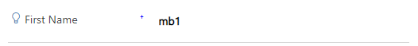
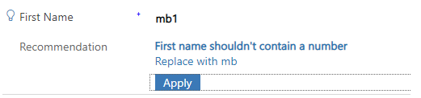

Previously we spoke about using the [setNotification](https://docs.microsoft.com/en-us/powerapps/developer/model-driven-apps/clientapi/reference/controls/setnotification) feature from the javascript SDK in this blog post but today we are going to talk about something similar but subtly different.

Today’s topic of discussion is [addNotification](https://docs.microsoft.com/en-us/powerapps/developer/model-driven-apps/clientapi/reference/controls/addnotification).

> formContext.getControl(arg).addNotification(notification);
> 
> Add a notification to a control sample code

The previous setNotification did one thing – put a big red warning on a field and prevented save and that’s pretty much it and looking at the line above, you’d imagine this does something as similar but you would be wrong – addNotification can be way more powerful as the `notification` parameter isn’t just a string, it’s a full object!

The notification to add. The object contains the following attributes:

> **actions**: (Optional) Array of objects. A collection of objects with the following attributes:
> 
> **messages**: Array of Strings. The message to display in the notification. In the current release, only the first message specified in this array will be displayed. The string that you specify here appears as bold text in the notification, and is typically used for title or subject of the notification. You should limit your message to 50 characters for optimal user experience.
> 
> **notificationLevel**: String. Defines the type of notification. Valid values are ERROR or RECOMMENDATION.
> 
> **uniqueId**: String. The ID to use to clear this notification when using the **clearNotification** method.
> 
> Parameter information from the documentation

Before I show some examples, the real power of addNotification is you customise the experience much more, you can give prompts that won’t disable user input and you can event interact with the earning to improve the user experience.

Again, we will use a hypothetical scenario where by you don’t want to allow numbers in your name fields but you want to help the user out a little bit instead of stopping them saving like our last example.

<pre><code>"use strict";

(function (globals) {

    globals.updateName = function(executionContext)
    {
        var formContext = executionContext.getFormContext();
        var firstNameAttr = formContext.getAttribute("firstname")
        var lastNameAttr = formContext.getAttribute("lastname");

        if (containsNumber(firstNameAttr.getValue())) {
            showSuggestion(firstNameAttr, "First name shouldn't contain a number", firstNameAttr.getValue());
        } else {
            clearSuggestion(firstNameAttr);
        }

        if (containsNumber(lastNameAttr.getValue())) {
            showSuggestion(lastNameAttr, "Last name shouldn't contain a number", lastNameAttr.getValue());
        } else {
            clearSuggestion(lastNameAttr);
        }
    }

    var containsNumber = function(value)
    {
        return /\d/.test(value); 
    }
    
    var showSuggestion = function (attr, message, value) {
        var safeValue = value.replace(/[0-9]/g, "");
        attr.controls.forEach(function (control) {
            control.addNotification({
                messages: [message],
                notificationLevel: "RECOMMENDATION",
                uniqueId: attr.getName(),
                actions: [
                    {
                        message: "Replace with " + safeValue,
                        actions: [
                            function () {
                                attr.setValue(safeValue);
                                clearSuggestion(attr);
                            }
                        ]
                    }
                ]
            });
        });
    };

    var clearSuggestion = function(attr)
    {
        attr.controls.forEach(function (control) {
            control.clearNotification(attr.getName());
        });
    }
}(this));</code></pre>

This code will not lock the form from saving now but it will pop up a recommendation to the user so they can make the suggest change on a single click.

<figcaption>You have a recommendation</figcaption>

It’s only subtle but it’s enough to grab most users attention during the point of entry. If you click the light bulb, it expands a little more and shows you the action text and an option to apply that change.

<figcaption>What will the recommendation do?</figcaption>

Simply clicking apply will now replace mb1 with mb and strip out all the numbers, meaning the user doesn’t need to retype that name out!

I’ve seen some fantastic uses of this recommendation system such as correcting typos in email address, recommending phone number formatting and auto setting/resetting linked fields – for example if you had industry and sub-industry, you could change the value of sub-industry based on a recommendation of the industry field!

There are still some other helpers I’m going to be looking at so I hope you can come back for the next one!
