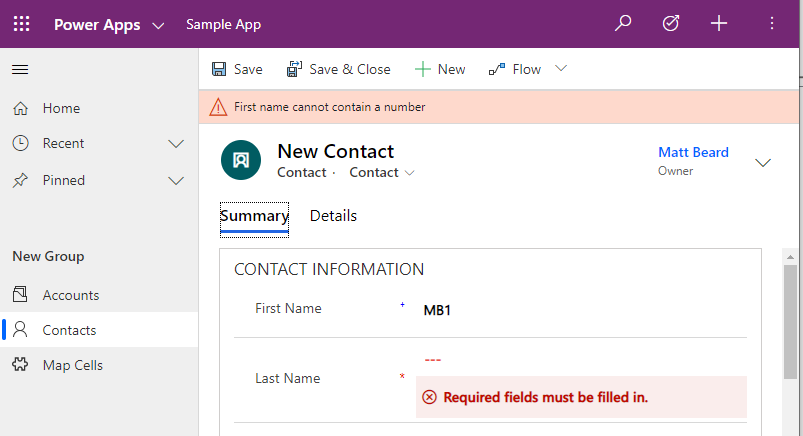
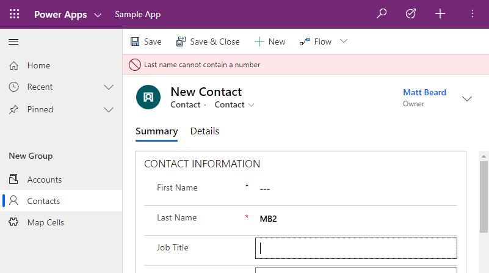
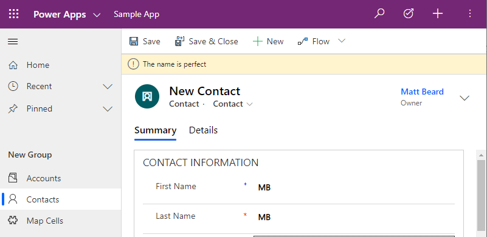
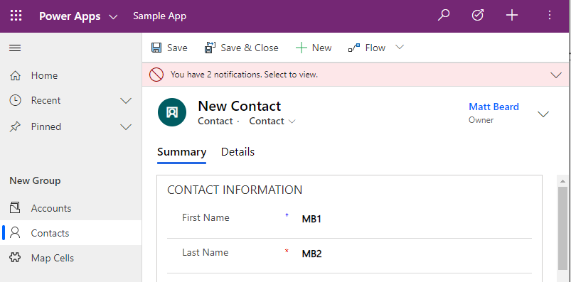
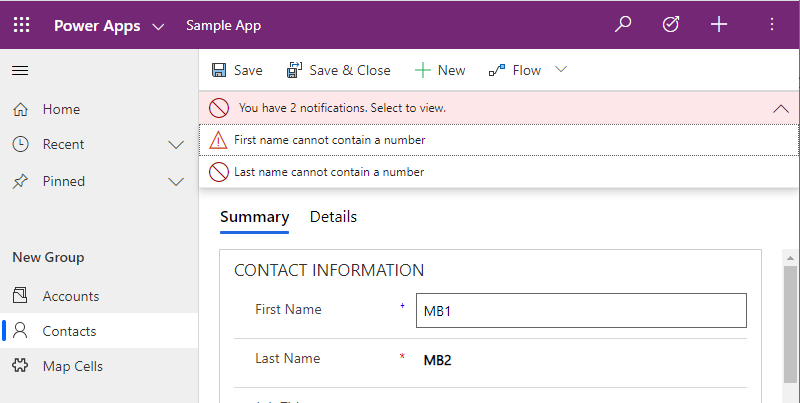

Welcome back to my third in the series of using the user interface to your advantage in model driven apps, if you have missed previous we have spoken about setNotification and addNotification so feel free to go and check them out.

All our previous blog posts were field specific and you could perform actions on the fields directly on the form. As the name alludes to, `setFormNotification` actually refers to the form as a whole and puts a global warning on the page. Official documentation can be found [here.](https://docs.microsoft.com/en-us/powerapps/developer/model-driven-apps/clientapi/reference/formcontext-ui/setformnotification)

> formContext.ui.setFormNotification(message, level, uniqueId);
> 
> Adding form notification in JS

Looking at the documentation, we have similar levels of notification like we have seen previously – Error, Warning & Info – which essentially will change the colour of the notification and the associated icon.

Let’s take an example that is similar to what we have been doing in the past few posts around numbers in names. In this case, if just the first name contains a number, we will pop up a warning but if the last name contains a number, we will pop up an error. Finally, just to show all three, we will show an info notification to confirm the name is fine.

<pre><code>"use strict";

(function (globals) {

    globals.updateName = function(executionContext)
    {
        var formContext = executionContext.getFormContext();
        var firstNameAttr = formContext.getAttribute("firstname")
        var lastNameAttr = formContext.getAttribute("lastname");
        
        var errored = false;

        if (containsNumber(lastNameAttr.getValue())) {
            formContext.ui.setFormNotification("Last name cannot contain a number", "ERROR", "lastNameId");
            errored = true;
        } else {
            formContext.ui.clearFormNotification("lastNameId")
        }

        if (containsNumber(firstNameAttr.getValue())) {
            formContext.ui.setFormNotification("First name cannot contain a number", "WARNING", "firstNameId");            
            errored = true;
        } else {
            formContext.ui.clearFormNotification("firstNameId")
        }

        if (!errored) {
            formContext.ui.setFormNotification("The name is perfect", "INFO", "noProblemId");                    
        } else{
            formContext.ui.clearFormNotification("noProblemId");
        }
       
    }

    var containsNumber = function(value)
    {
        return /\d/.test(value); 
    }
}(this));</code></pre>

On change of a first name or last name now, we should get some sort of form notification so let’s go and test it.

<figcaption>The warning notification</figcaption>

<figcaption>The error notification</figcaption>

<figcaption>The info notification</figcaption>

Success, all working as one would expect but there is something else that I haven’t really touched on yet but it has been there for the last few posts – the unique id part of the javascript. What’s the point on it? The truth is all my demo images above only show a single warning but this doesn’t need to be the case and you can actually have as many warnings as you want and they will all stack. The unique id is the part that ensures you remove the correct warning.

If I go back and put a number in both first and last name, you will see the following:

<figcaption>Multiple notifications</figcaption>

We now have multiple notifications stacked with a count and an option to view. Note here we are seeing the “ERROR” icon – the system when condensing multiple warnings will summarise it with the most severe icon which is a neat touch. If you expand, this is what you will see.

<figcaption>Multiple notification expanded</figcaption>

For me personally it raises on issue and is actually a regression. Everything you’re seeing here is on the unified interface which is pretty much what everyone will be using now but back in ye olde days on the legacy interface if you had multiple notifications they were, by default, all visible and didn’t require that extra click. For me that’s preferable but I’m sure Microsoft has other metrics that made them decide to condense and summarize.

I’d love to know if you’ve used setFormNotification at all and if so, how?

Thanks for reading.
