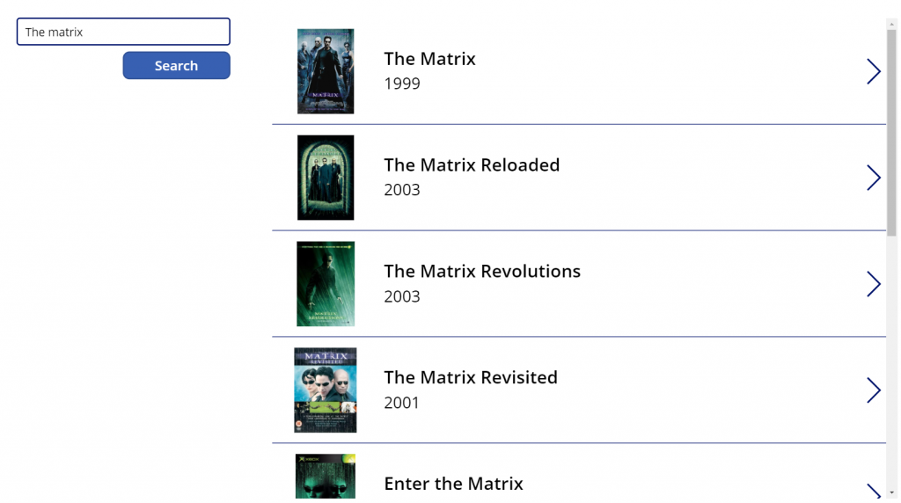
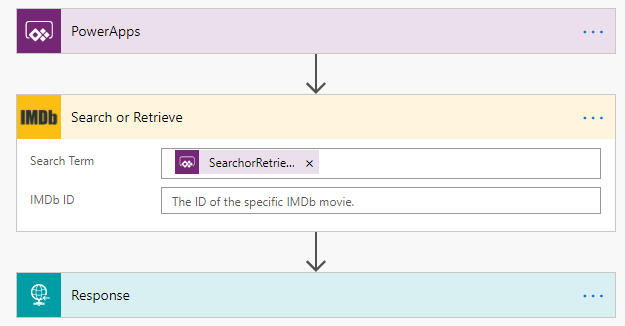
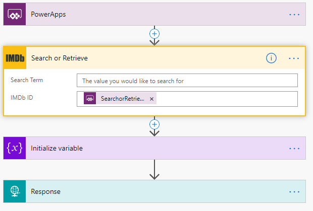
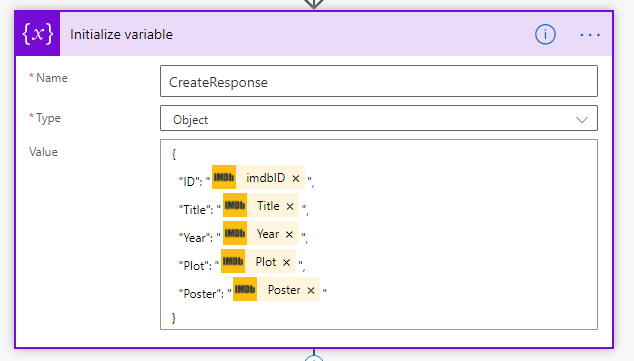

Welcome back to my second post on custom connectors I’m going to open source, if you missed the first one around [What3Words](/blog/2020-10-02/) I’d love you to go and check it out.

The connector is available here for you to download:

[https://github.com/mattybeard/PowerAutomate\_CustomConnectors/tree/master/OMDb](https://github.com/mattybeard/PowerAutomate_CustomConnectors/tree/master/OMDb)

**What is the connector for?**

This connector is a little unique – officially I’m calling the OMDb API which can be found here ([http://www.omdbapi.com](http://www.omdbapi.com/)/) which then indirectly is calling the IMDb API. The IMDb API is a little more difficult to get direct access to so by using OMDb I’m getting the same data but with less intial set up headaches – win win (win)! N.B. Bonus points to you if you understand that reference, tell me on Twitter if you do!

**What does the connector do?**

The OMDb API is super simple and only has a single endpoint which performs all the magic. Ideally I would’ve split this out to separate actions for ease in Power Automate but sadly as the main url is the same for all actions, Power Automate and Swagger don’t like that which means we are having to use a single action and we can decide what we want to do based on the parameter we use and we can do one of two things – search and retrieve.

**Searching**

In order to a search for a movie, just populate the `Search Term` parameter. This is an example of how my proof of concept canvas apps looks.

<figcaption>Canvas app searching IMDb via OMDb</figcaption>

This is calling a super simple 3 step flow from Power Automate. Some of the true magic comes from a tip that’s stuck with me for a long time from [Brian Dang](https://twitter.com/mrdang) around returning structured data from Power Automate by using the Response action – super clever stuff!

That’s it – a single search term linked to a button and we have full IMDb searching.

**Retrieval**

The retrieval process is just an simple to actually get the data but we need an additional step to return the data to the the Power App. This is the flow and I’ll explain the small difference.

<figcaption>Retrieve flow</figcaption>

You’ll notice an additional “Initialize variable” step that we didn’t have previous – the main reason for this is when we get the data back from the connector, it’s a single record – but my Power App would like a more complex object to avoid making the request multiple times. If I expand the `Initialize variable` step, it should make sense.

This just means I can get all that data on a single pass, rather than making lots of different Flows do the same thing but return something slightly different.

That’s it! Super simple and now we can query IMDb with both searching and retrieval.

As always you’re welcome to use the connector as you see fit but for full disclosure I do not own the API driving the connector.
