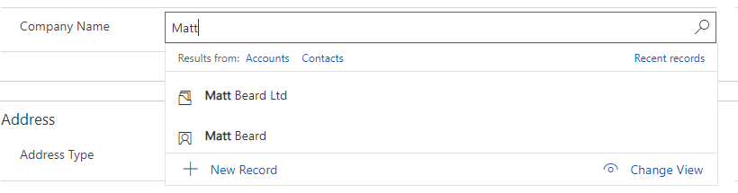
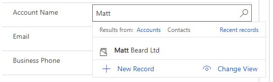

Welcome back to the ongoing series of how we can use and manipulate the user interface to your advantage in model driven apps in fully supported ways. We have discussed a number of options in the past and you can find them all with the search tag [user-interface](/blog/tag/user-interface/).

Todays isn’t so obvious on the actual user interface – but if one that is often forgotten. There are a number of posts on this topic, including a great one from my friend [Joe Griffin which does cover a similar thing](https://crmchap.co.uk/more-adventures-in-pre-filtering-customer-lookup-fields-dynamics-crmdynamics-365-for-enterprise/) but I’ve tried to modernise this in the unified interface – I know a lot of people are now joining the model driven world who have never seen these things before so it’s something definitely worth talking about.

For that reason, today we are talking about [addPreSearch](https://docs.microsoft.com/en-us/powerapps/developer/model-driven-apps/clientapi/reference/events/presearch). Strictly speaking, I guess this is more UX than UI – but it fits in with the message I’m trying to get across so I’m sure you’ll let me off.

`addPreSearch` is fantastic and honestly, I didn’t even realise it was a thing until I started to write this series. Essentially, PreSearch is an event which we can extend by using `addPreSearch` (and `removePreSearch`) to manipulate a search control in a way we require.

What does this mean in practical terms? Well out of the box, the contact entity has a parentcustomerid field – which is a customer field. This means a parentcustomerid can be either an account OR a contact.

Whilst this is useful, I’ve seen lots of customer have required where this should only ever be an account. Whilst we can easily enforce this in plugins, it’s doesn’t feel nice to show a massive alert on the screen and make the user go back to change it, so let’s use `addPreSearch` to improve that UI.

The way `addPreSearch` works is that it expects a function as it’s parameter and within that function, you can do whatever you want but the thing that makes most sense in this context is [addCustomFilter](https://docs.microsoft.com/en-us/powerapps/developer/model-driven-apps/clientapi/reference/controls/addcustomfilter), which adds an additional “AND” clause to the filter.

<pre><code>"use strict";

(function (globals) {

    var formContext;

    var onlyShowAccounts = function() {
        var accFilter = 
        "&lt;filter&gt;" +
            "&lt;condition attribute='contactid' operator='null' /&gt;" +
         "&lt;/filter&gt;";

         formContext.getControl("parentcustomerid").addCustomFilter(accFilter, "contact");
    }

    globals.accountPreSearch = function(executionContext)
    {
        formContext = executionContext.getFormContext();
        formContext.getControl("parentcustomerid").addPreSearch(onlyShowAccounts);        
    }

    
}(this));</code></pre>

In this simple example, I’m adding an additional filter to the fetchxml where contactid is null – which is impossible for a contact and therefore removes all contacts from my results!

The result as you can see on the same dataset doesn’t give me any contacts at all, which is exactly what I was trying to achieve.

What other use cases have you seen for `addPreSearch`? I’d genuinely love to hear them.
