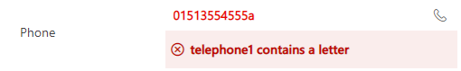
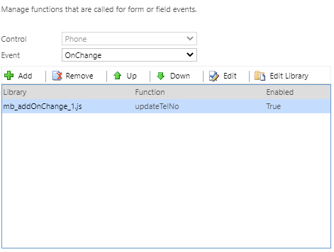
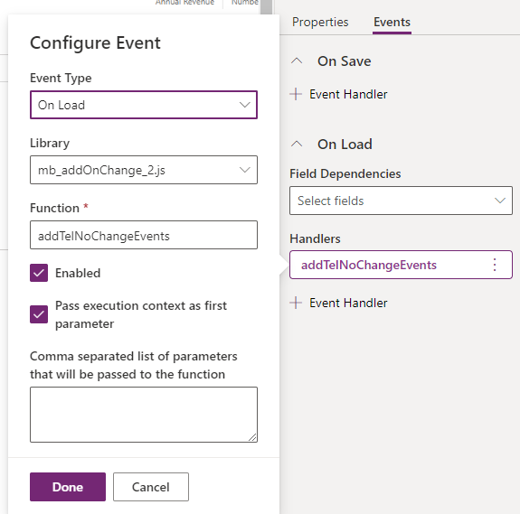
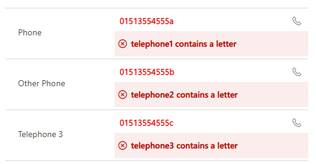

Welcome back to the ongoing series of how we can use and manipulate the user interface to your advantage in model driven apps in fully supported ways. We have discussed a number of options in the past and you can find them all with the search tag [user-interface](/blog/tag/user-interface/).

Like my previous post on [addPreSearch](/blog/2020-11-03/), this strictly isn’t UI and is more UX but I think [addOnChange](https://docs.microsoft.com/en-us/powerapps/developer/model-driven-apps/clientapi/reference/attributes/addonchange) should become a staple of any developer in order to keep a consistent message and helps things not get forgotten.

addOnChange is function that allows you tell the system what should happen when a field changes – so essentially it’s code inception as this code itself won’t change the UI but will set the places which will change. Let me give a better example.

Let’s imagine that you want to set up an onChange event that runs every time you update a phone number and we want that onChange to show an alert on the field if it contains anything other than a number. This would be my code.

<pre><code>"use strict";

(function (globals) {

    globals.updateTelNo = function(executionContext)
    {
        var attr = executionContext.getEventSource();    
        if (!isOnlyNumber(attr.getValue())) {
            showNotification(attr, attr.getName() + " contains a letter");
        } 
        else {
            clearNotification(attr);
        }
    }

    var isOnlyNumber = function(value)
    {
        return /^\d+$/.test(value); 
    }
    
    var showNotification = function (attr, message) {
        attr.controls.forEach(function (control) {
            control.setNotification(message, attr.getName());
        });
    };

    var clearNotification = function(attr)
    {
        attr.controls.forEach(function (control) {
            control.clearNotification(attr.getName());
        });
    }
}(this));</code></pre>

This will run on an attribute and upon change, will give me an alert like so:

In order for this to go on my form, I need to add an event handler to the field which makes it trigger (and at the time of writing, I have to go to classic mode to do it).

But here is my problem – I have more than one telephone field and I really don’t want to have to do that multiple times. Add that to the fact there is absolutely a change I might need to add more phone numbers fields to my account in the future and each time I do, I need to remember to do the same thing. This is where `addOnChange` simplifies everything. What about if we make it a little dynamic and only ever have to do it once and can forget about it? So I’m going to add one more method to the code and tweak the form a bit. I’m going to add this method which makes use of `addOnChange`.

<pre><code> globals.addTelNoChangeEvents = function(executionContext) 
    {
        var formContext = executionContext.getFormContext();
        formContext.data.entity.attributes.forEach(function(attr) {
            if (attr.getFormat() == "phone")
            {
                attr.addOnChange(updateTelNo);                
            }
        });
    }</code></pre>

This bit of code to me is so simple, yet so effective. It will load in every single attribute on my form, look if it’s defined in metadata as a phone field and if so, automatically add the onChange event so I never need to worry about adding telephone fields again. I can now remove all of my onChange events I’d added manually and just add this single method to my onLoad instead and what’s even better – onLoad is available on the maker experience!

And the final result on the form:

For me, that is such a time saver!

What other clever usages can you think or have you seen?
