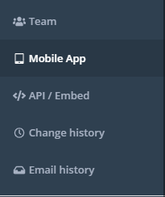
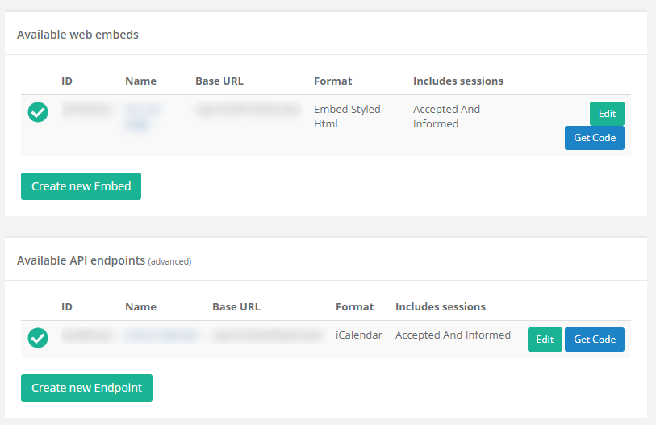
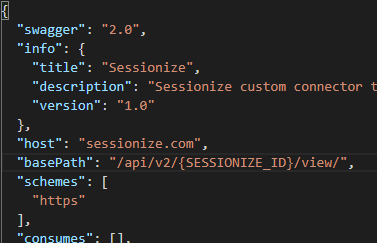

Welcome back to my third post on custom connectors I’m going to open source – my previous two being [What3Words](/blog/2020-10-02/) and [OMDb](/blog/2020-10-29/).

The subject of this custom connector is probably the most commonly used event management platform, [Sessionize](https://sessionize.com/). Sessionize is a website designed to handle call for speakers, agendas and pretty much anything around events and since the global pandemic, teams have relied on Sessionize even more to organize virtual events.

Last year, two friends of mine called Mark Christie and Iain Connolly organized the Scottish Summit and they used Sessionize to plan the event. During the early days of organization, they decided they wanted to be bigger than most other events out there and have an app that attendees on the day would use to find their way around, plan the day and even network with. The problem was that Sessionize had been used to organize the event and a different system was being used to handle the app and something was needed to bridge the gap.

At this point, I was talking with the guys and we all decided that this would be a perfect task for Power Automate to keep it in sync, meaning they only ever had to worry about Sessionize and the app would auto sync when changes were made – this is where I came in and due to a great Sessionize API a custom connector was created.

The connector is available here for you to download:

[https://github.com/mattybeard/PowerAutomate\_CustomConnectors/tree/master/Sessionize](https://github.com/mattybeard/PowerAutomate_CustomConnectors/tree/master/Sessionize)

**How to use the connector?**

This connector is a little weird for initial set up and that’s all down to Sessionize and how their API works. Sessionize don’t actually authenticate their API but you do get a fully unique URL for your event. This makes sharing the connector a little difficult and you will need to make one edit before you can use it.

In Sessionize, go to your event and on the left hand side, you can see API/Embed. Click this option.

<figcaption>Sessionize Options</figcaption>

From here, you want the second option “Create New Endpoint”.

On the next page, give it a name (anything you want!) and select “JSON” as your format. Everything else on this page you can customize as you wish.

Once you’re happy to do, click “Create Endpoint” and you’ll be redirected and should see your new Endpoint. The thing we care about here is the “ID” – so copy and paste this and as we will use it shortly.

If you download the Sessionize.swagger.json file from Github, please open it in the text editor of your choice. What you should see under the `basePath` field is `{SESSIONIZE_ID}`. You need to replace this with the ID you got from Sessionize.

Save and that’s it! You’ve got a Sessionize connector connected to your event.

As always you’re welcome to use the connector as you see fit but for full disclosure I do not own the API driving the connector.
