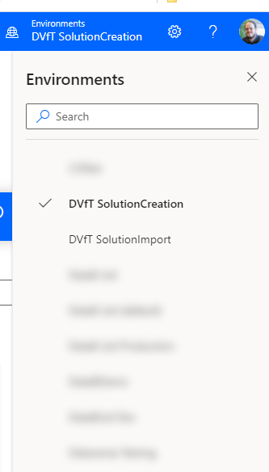
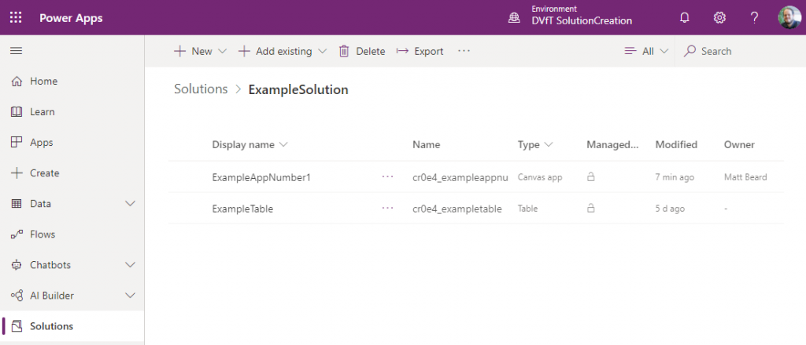
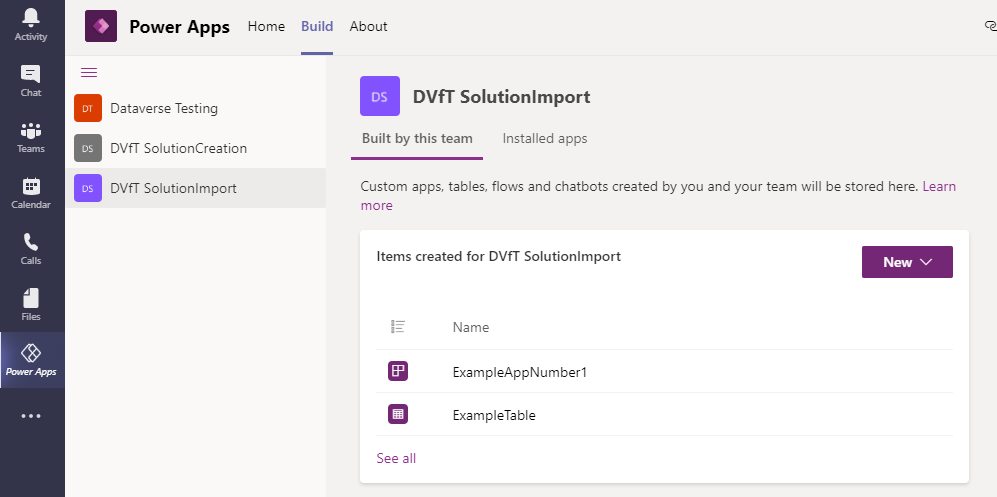

I was thinking about the wider Power Platform whilst playing with Dataverse for Teams and it struck me that there doesn’t seem an obvious way to move things between different Dataverse for Teams environments – which means once you have made something, it will live within your team and nowhere else – if you wanted to move it or copy it, you have to do it manually.

Or do you?

I have 2 environments for the purpose of this blog post:

-   1\) DVfT SolutionCreation
-   2\) DVfT SolutionImport

I simply want to make my stuff in environment 1 and via a solution, import my stuff into environment 2. I will need to have made a Dataverse for Teams environment in my destination team – so I’ve made the assumption you’ve done that. If you haven’t, just make a quick sample app or bot.

Now we have to get clever – open up two tabs in your web browser. In one, go the Power Automate (https://flow.microsoft.com) and in the other head to the Power Apps makers portal (https://make.powerapps.com). In the Power Automate tab, you’ll notice that in the environment picker, you can select your source environment (in my case, DVfT SolutionCreation) but in the Power Apps tab, you cannot select your source environment.

<figcaption>Dataverse for Teams environment in Power Automate</figcaption>

In the Power Automate tab, select your source location and make a note of the URL. It’ll be something like this:

`https://emea.flow.microsoft.com/en-us/?environment=4d1c7d61-8711-4ddc-a27e-9f0168f78907`

Copy the GUID within the URL onto your clipboard. Now in the Power Apps table go to (replacing the GUID with the GUID on your clipboard).

`https://make.powerapps.com/environments/4d1c7d61-8711-4ddc-a27e-9f0168f78907/home`

Notice now that even though you couldnt select the environment, you’re actually now in it – full maker experience (with caveats) for a Dataverse For Teams environment.

<figcaption>Dataverse for Teams in make.powerapps.com</figcaption>

From here, follow your normal procedure. Head to solutions, create a new solution (note, you will NOT be able to make a new publisher, you’re stuck with the default one I’m afraid), and add in whatever you want to.

<figcaption>Normal solution building in Dataverse for Teams</figcaption>

Extract your solution – NOTE: I’ve not fully tested how managed vs unmanaged will work here, so for the purposes of this demo I’m going unmanaged but I’ll leave that hot topic for a later post.

Now using Power Automate, find the GUID of your destination environment and follow the same steps, so in my case `https://emea.flow.microsoft.com/en-us/?environment=13f5842e-6092-464a-a256-f71f161b40c3` becomes `https://make.powerapps.com/environments/13f5842e-6092-464a-a256-f71f161b40c3/home`.

Import your solution!

A publish all and voila. You’ve taken your stuff across to a different environment. If I open Teams up to edit the app further, I can now do my usual things like publish it to the Team etc.

There are restrictions I’ve hit in playing with this – most importantly I’m going to say this is unsupported and entirely undocumented so do it at your own peril. I’ve also found that anything that would require the classic interface to open (making a new publisher for example) just get’s your stuck in a loop before eventually erroring. Another issue I’ve found is because you have full maker experience, you’d think you could make a model driven app now but sadly, you’d be wrong and this results in that same redirection loop.

My ultimate aim in all this was so I can have backups of everything as solutions and this certainly works for that reason!

Hope you enjoyed.
