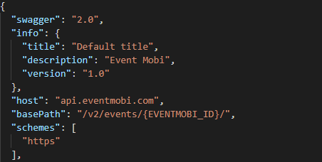

Welcome back to my fourth post on custom connectors I’m going to open source and this one almost immediately follows on from the previous [Sessionize](/blog/2020-11-26/) one.

As mentioned in the previous post, Sessionize was used to help speakers organize their tracks for Scottish Summit in 2020. 2021 is no different and even though the event is virtual Scottish Summit 2021 is going to be even bigger so Sessionize is even more crucial to help speakers.

This time around, the organizers decided to change the technology they use slightly and provide an app to all virtual attendees. This is a fantastic idea and will really add to the event – but that data lives somewhere else and Power Automate is here to the rescue.

The technology behind Scottish Summit this time around is called [EventMobi](https://www.eventmobi.com/) which has an API. As I’ve build the custom connector and got the sync between EventMobi and Sessionize working I thought it might be useful to open source and share so that event attendees can even see that the events themselves use the core Microsoft technologies.

The connector is available for you to download here:  
[https://github.com/mattybeard/PowerAutomate\_CustomConnectors/tree/master/EventMobi](https://github.com/mattybeard/PowerAutomate_CustomConnectors/tree/master/EventMobi)

**How to use the connector?**

This connector is a little weird for initial set up, much like Sessionize and that’s all down to EventMobi and how their API works. EventMobi use an API key to their API but you ALSO get a fully unique URL for your event. This makes sharing the connector a little difficult and you will need to make one edit before you can use it.

The magic in the EventMobi API is done at their API centre here: [https://experience.eventmobi.com/](https://experience.eventmobi.com/)

You will need to follow all the steps until you get the chance to generate a key and then you should have everything you need.

If you download the EventMobi.swagger.json file from Github, please open it in the text editor of your choice. What you should see under the `basePath` field is `{EVENTMOBI_ID}`. You need to replace this with the ID you got from EventMobi.

Save and that’s it! You’ve got a EventMobi connector connected to your event.
