Recently I’ve made a few blog posts in custom connector series around Sessionize and Event Mobi and how they are used by the Scottish Summit organizers. Whilst I was writing those blog posts, I thought it might be useful to share the end game of those custom connectors and how they are keeping the Scottish Summit app in sync so here are some screenshots and explanations.

[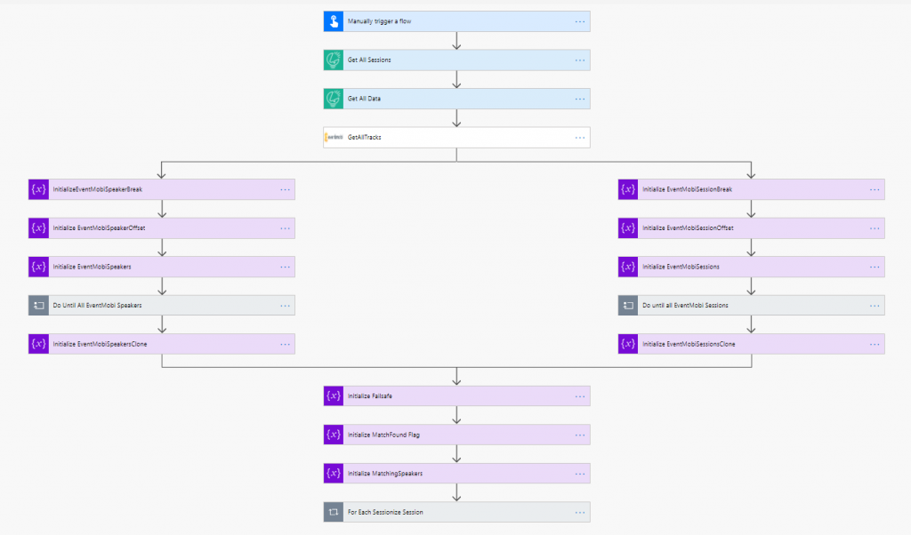](images/image-1.png)

<figcaption>Top down view of the Scottish Summit Sync</figcaption>

The biggest problem I faced throughout this whole Flow build was that EventMobi and Sessionize both used their own ID’s for everything – including tracks, rooms and speakers. Whilst EventMobi does allow you to specify the ID on creation, the tracks, rooms and speakers were pre-made meaning I couldn’t rely on consistency – but because I’m making the sessions themselves I will use the Sessionize ID meaning I can run this Flow as many times as I want once I get everything else correct.

Let’s break down the top part first:

[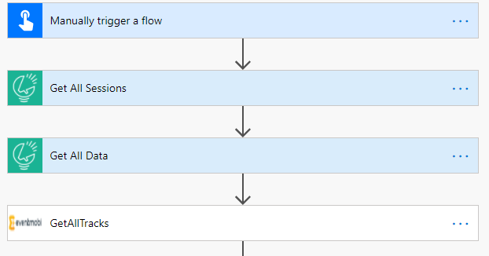](images/image-3.png)

<figcaption>Loading in the initial data</figcaption>

This part is fairly self explanatory and is doing some preliminary loading for things that I’m going to need later on. From here, we can paralellize slightly just to do two things in one go.

[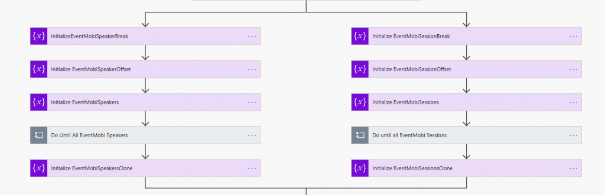](images/image-4.png)

<figcaption>Initialize and set up variables</figcaption>

Later on, we are going to need to map Sessionize elements to their EventMobi counterpart. Last year when I did this, I used a Dataverse middle layer and stored it in custom entities but this year I decided to do it on the fly.

The other thing to mention here is EventMobi is paginated – meaning the GetAllSpeakers call won’t get me ALL speakers – but will get me a page of speakers and I have to do more logic. If I expand one of the “Do Until” you see above, I simply iterate through until I have all of the speakers/sessions.

[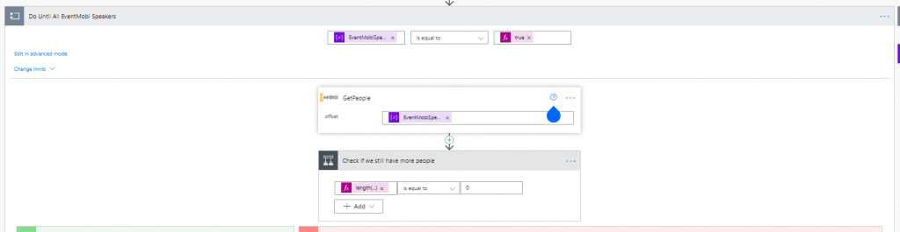](images/image-5.png)

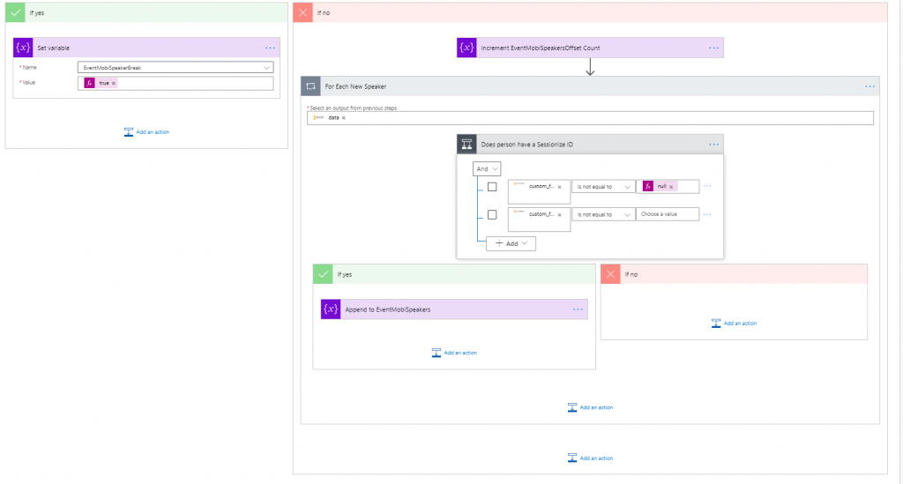

<figcaption>Loading in all the speakers</figcaption>

This looks complicated but it really isn’t. I simple have a variable that stores my offset, starting at 0. I load in the page with that offset – if I don’t have anyone in my results then I’ve done everything, otherwise I go and loop through my people. Remember – EventMobi doesn’t only contain my speakers, it also contains all the attendees to BUT this Flow doesn’t need to worry about them as they won’t be speaking so I loop through my speakers and if they have a SessionizeID, I add them to an array.

I could’ve done this simpler in a filter array in hindsight but I’d already written it in this logical way and didn’t need to change it.

Now I have all the EventMobi Speakers and EventMobi sessions loaded into memory to so the next part can be efficient.

[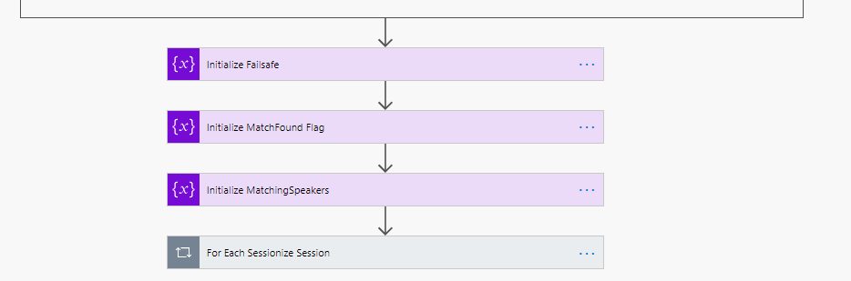](images/image-8.png)

<figcaption>The final stage</figcaption>

I love how simple Flows look when they are condensed…

Finally I initialize a few other variables I’ll be re-using and then it’s time to dig into the main part – what I do with each Sessionize Session, so let’s expand that.

[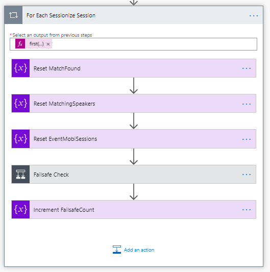](images/image-9.png)

<figcaption>For each Sessionize session…</figcaption>

This is a disappointing next screenshot but but it’s a necessary one. Firstly, I reset all the variables I’ll be using and then I do a failsafe check – I built this in so I could make it do 1 or 2 sessions then stop, rather than me having to wait for full Flow completion every time. The real guts is within the Failsafe check.

[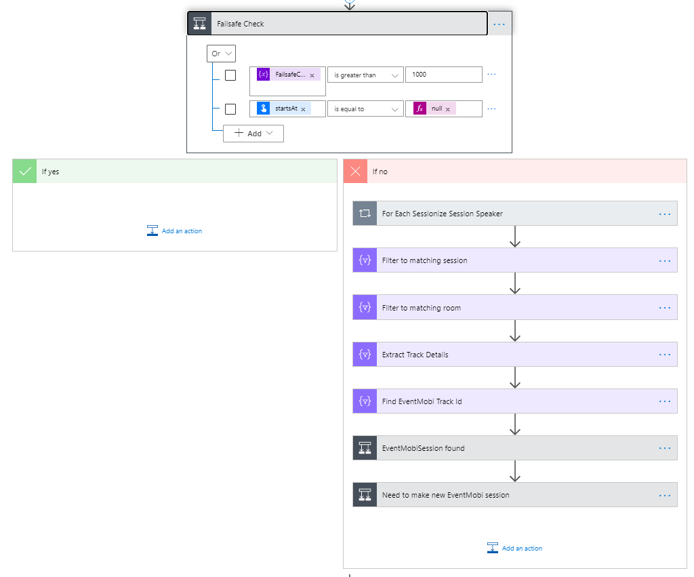](images/image-10.png)

<figcaption>Actually for each Sessionize Session</figcaption>

Once I pass my failsafe check, I can do some real work!

[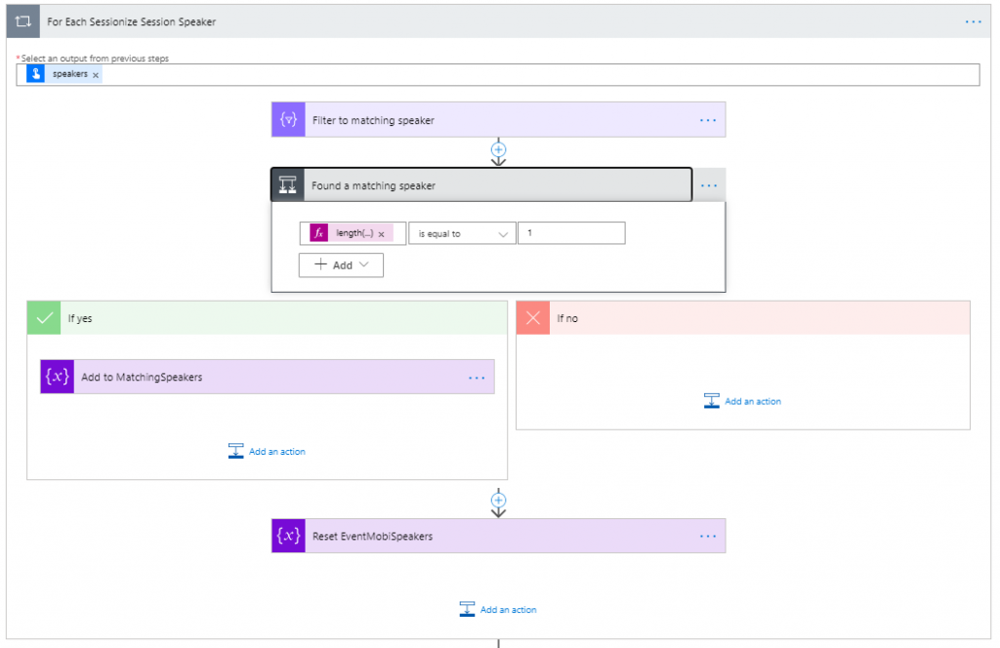](images/image-11.png)

<figcaption>For each speaker…</figcaption>

Firstly, now my context is a Sessionize session, I can loop through each speaker in that session (most only have one but some do have multiple) and go and find the corresponding EventMobi speaker so I know who to use later on. I filter the EventMobi speakers to anyone with the matching SessionizeID and assuming I find one, I add them to the array.

[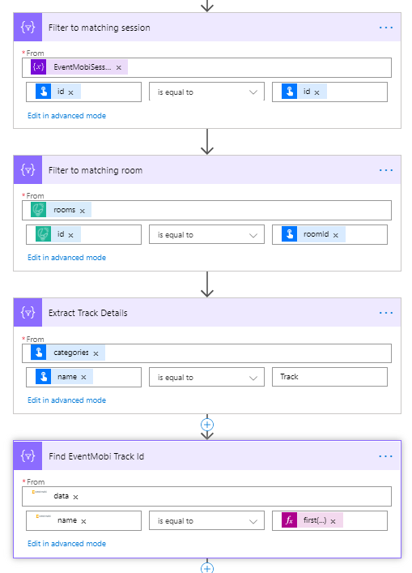](images/image-12.png)

<figcaption>Getting the metadata</figcaption>

I then rinse and repeat this for all the other things that I will be using – but I can be sure these are only in there once so I can make it a little simpler. Above I’m trying to find the matching EventMobi room and track.

[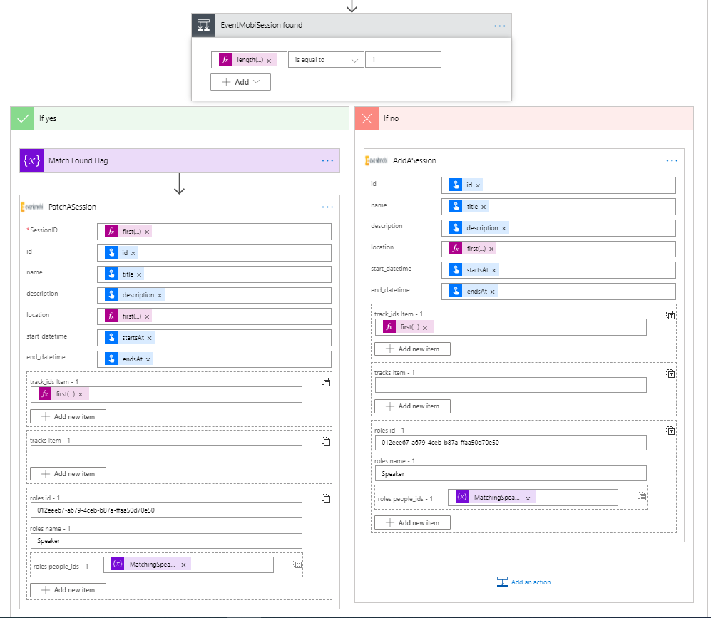](images/image-14.png)

<figcaption>PATCH or POST</figcaption>

Now at this point, I have all these details available to me:

-   The Sessionize session details
-   The matching EventMobi session if created
-   The matching EventMobi speakers
-   The matching EventMobi room
-   The matching EventMobi track

This means I have everything I need and I just have to do the final magic part.

The if check is is checking if the matching EventMobi session exists or not i.e. should I update an existing or create a new one? If it exists, fantastic then I can update it otherwise, I’ll make a new session!

And that’s it! Simple as that!

I don’t often build Flows that require production level speeds so I’ve not made it as efficient as I possibly could have – so if you have any tips on how to improve I would honestly love to hear about them!

Hopefully I’ll see you at Scottish Summit 2021!
