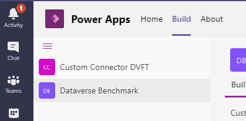
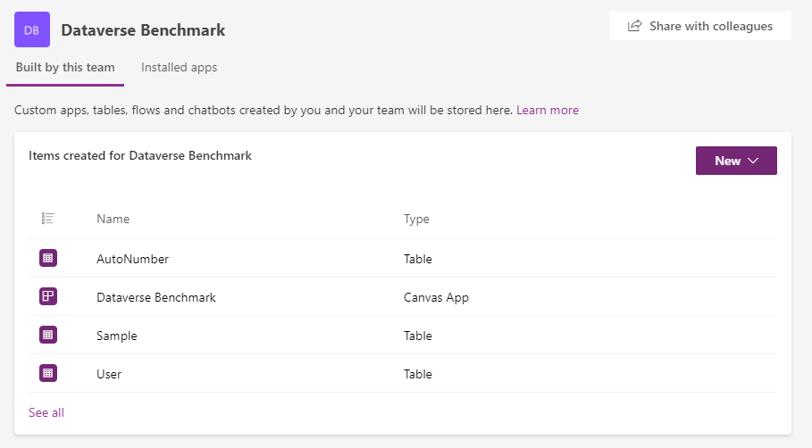
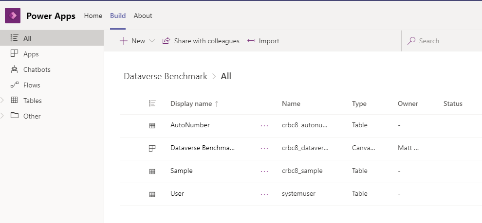

It’s been a month and a half since I posted a workaround in how you can handle ALM and manage solutions in Dataverse for Teams, despite it not being obvious. The post can be found here if you missed it:

> [Moving solutions between Dataverse for Teams environments](/blog/2020-11-27/)

Since then, it looks like Dataverse for Teams has evolved slightly and now HALF of what the blog post can be done and is officially supported – you can now IMPORT solutions into Dataverse for Teams so I thought it might be worth sharing the officially supported way.

This tweet from [Manuela Pichler](https://twitter.com/ManuelaPichler_/status/1347237147833741312) alerted me to this blog post from Microsoft

[https://docs.microsoft.com/en-us/power-platform/guidance/coe/setup-innovationbacklog#option-2-import-the-solution-into-a-dataverse-for-teams-environment](https://docs.microsoft.com/en-us/power-platform/guidance/coe/setup-innovationbacklog#option-2-import-the-solution-into-a-dataverse-for-teams-environment)

Firstly open the “PowerApps” app within Microsoft Teams and then navigate to the “Build” tab.

Pick your Dataverse for Teams environment of choice and see all the items of the environment listed on the right hand side.

And we have “See all” which until now I’d never actually clicked but let’s click on it for now.

This will now list all items but notice the top bar – we have an import button! Clicking this now gives you the modern solution import experience.

Whilst it’s a little annoying to break that muscle memory in how to import a solution into Dataverse for Teams, it’s nice to know that importing solutions is supported and I hope that better solution management is on it’s way in due time!
