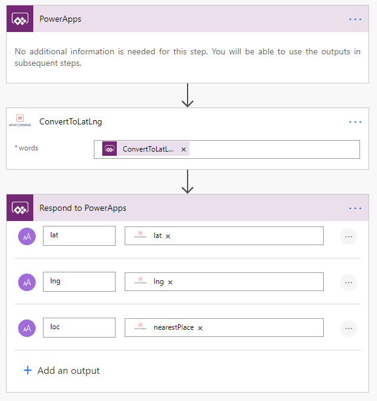
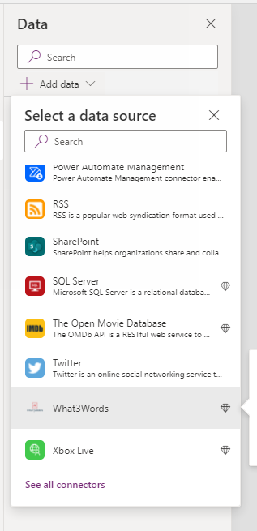
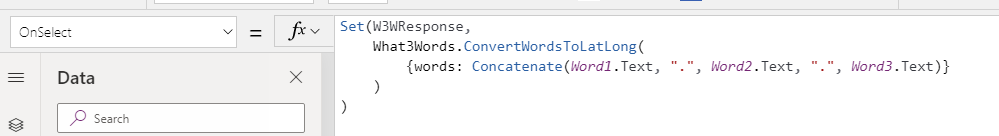
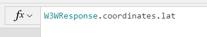
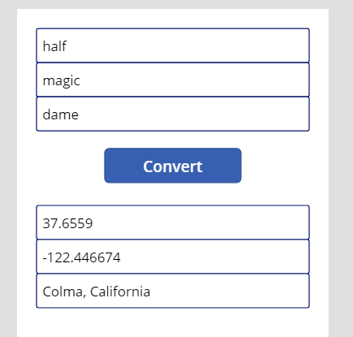

Recently during a session at D365UGUK by Rob Dawson, I had a penny drop moment due to Rob doing something in a way that has simply never occurred to me before so I took some time to go and investigate for myself and it turns out I was doing some things in canvas apps WAY more complicated that I needed to – and if I’m doing it then no doubt someone else somewhere else is also doing it so hopefully they stumble upon this blog post.

For this blog post, I’ll go back to my usual go to demonstration which is What3Words and I’ll use my What3Words custom connector I wrote a little while ago ([blog post here for those interested](/blog/2020-10-02/)) and essentially I want to turn 3 words into a latitude and longitude. Previously, I set up a Flow in Power Automate than ran on button press and passed the response back to Power Apps as you can see in this image.

Now I’ve realised that this Flow isn’t required at all and I can minimize the amount of Flows used by Power Apps significantly!

Now I can start by adding a connector as a data source into my canvas app which has been in front of my eyes for all this time and I’d never actually read it.

By adding this in as “data” – and I think the reason it’s classed as “data” is why I’d bypassed it before as that isn’t really an accurate description of anything my connector does – I now get all the actions in my canvas app to use in the canvas apps language and perform all sorts of magic. In this case, I’m going to use it on press of a button.

And I’m genuinely amazed, that is it. I now have a variable I can – with intelligent dynamic selections thanks for the custom connector metadata and I can do some amazing stuff fast!

And the result, without a Flow in site…

So I went back to test something I built years ago, using the “[Data8 Data Enrichment](https://docs.microsoft.com/en-gb/connectors/data8/)” connector which I authored and got published some time ago and lo and behold by using the OnChange features, within minutes, I had real time validation of data and I was amazed I’d missed this all that time.

