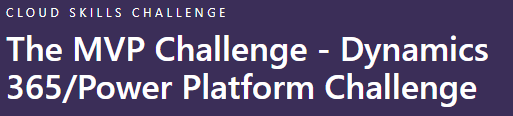

On May 1st, I was honoured to be awarded Microsoft MVP in the Business Application category and I was well and truly humbled.

[An image in the original post is no longer available.](https://media-exp1.licdn.com/dms/image/C4D22AQEapRrmWC_EDQ/feedshare-shrink_1280/0/1619886125904?e=1625702400&v=beta&t=6teBQ61tmjBVB0OK79fxqRstkOjQpsltjs_1bSmYT_I) [Original image source](https://media-exp1.licdn.com/dms/image/C4D22AQEapRrmWC_EDQ/feedshare-shrink_1280/0/1619886125904?e=1625702400&v=beta&t=6teBQ61tmjBVB0OK79fxqRstkOjQpsltjs_1bSmYT_I).

<figcaption>Awarded MVP</figcaption>

Since then however, it’s truly been non stop with all sorts of changes coming at me. One of the things I saw when I was first awarded was call the MVP Challenge which was a challenge all focussed on learning.

One thing I’m proud to admit is I barely know anything in the grand scheme of things and there is always a huge amount for me to learn. Some of this will help my career and some of this I’ll think “this is cool” but then never go near again and some I’ll dislike – and that’s all fine. Keeping your brain thinking, active and learning is a great challenge in life and one I’m fortunate enough to enjoy.

During the MVP challenge, I completed 40 courses on [Microsoft Learn](https://docs.microsoft.com/en-us/learn/) – some I knew and it was a nice refresher, some I’d heard of but never actually knew what it meant and some I’d never heard of and it was all totally brand new to me but after a few days of knuckling down, I was 40 for 40 on courses and I must say, some of the Learn docs are fantastic.

I was having a conversation with my Dad about Business Applications and it was a subject matter we had in common that we didn’t realise, and I was able to open his eyes to the wider power of the platform with things like Power Automate. To be having conversations like this with my Dad and to have these shared aspects of our careers without ever knowing was very exciting and gave me an even bigger level of pride for my recently awarded MVP status.

Thinking back to Microsoft Learn, ironically, one of the things I learned about during this was how Learn itself works, it never occurred to me how I can make a collection of modules and pass them to others to them in turn learn – so this is what I did to my Dad. Once we got talking more and I had an idea of the areas he’d seen and not seen, I added some modules on some of the things I work on daily to a collection. This meant I was educating him on new things he could do but he was also being educated on the sort of things his son does for a job and that was quite an honour. We now have even more in common and respect for one another’s jobs.

So, I’ve edited the collection slightly and I’ve put it public – to show you the sort of simple, yet ground-breaking collection of modules that not only expand knowledge but can actually bring people together. This is an ever growing work in progress but it shows the simplicity of shared learning and the impact it has.

[https://docs.microsoft.com/en-us/users/mattbeard7/collections/m0kug018rd6r3](https://docs.microsoft.com/en-us/users/mattbeard7/collections/m0kug018rd6r3)

So my next job is to make a harder collection and, in true role reversal of years earlier, give my Dad homework!
