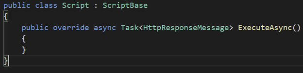
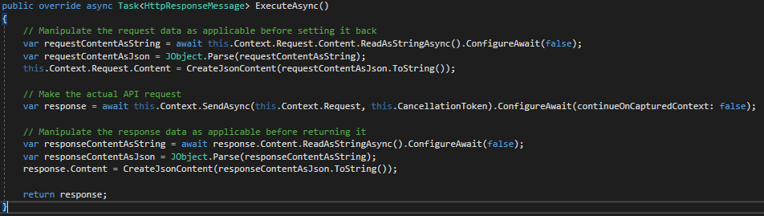
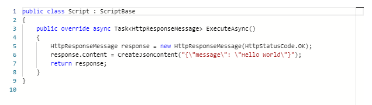
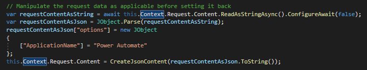

A new feature has recently got into public preview by Microsoft, which is the ability to manipulate your requests and or responses from a custom connector within the Power Automate platform. This, as far as I can remember, is the first time that a fully supported way of writing and running C# (or a subset of it – more on that later) directly on the low code platform has been given to us and as a developer, that excites me.

What this enables us to do is create a file that runs a method names `ExecuteAsync` within a class called `Script`. This script in itself must implement `ScriptBase` which is a base class defined by Microsoft. I’ve created a skeleton project which you can download from here (https://github.com/mattybeard/PowerAutomate\_Scripting) and use if you wish – just to help you with the intellisense.

<figcaption>Skeleton Method of ExecuteAsync</figcaption>

Within this `ExecuteAsync` method you can access the input of your request just before it hits it’s own API so you can make some manipulations. You can then make the actual request and then manipulate the response if you wish.

## Writing The Code

<figcaption>Visual Studio of the boiler plate code</figcaption>

<pre><code>public override async Task&lt;HttpResponseMessage&gt; ExecuteAsync()
        {
            // Manipulate the request data as applicable before setting it back
            var requestContentAsString = await this.Context.Request.Content.ReadAsStringAsync().ConfigureAwait(false);
            var requestContentAsJson = JObject.Parse(requestContentAsString);
            this.Context.Request.Content = CreateJsonContent(requestContentAsJson.ToString());

            // Make the actual API request
            var response = await this.Context.SendAsync(this.Context.Request, this.CancellationToken).ConfigureAwait(continueOnCapturedContext: false);
            
            // Manipulate the response data as applicable before returning it
            var responseContentAsString = await response.Content.ReadAsStringAsync().ConfigureAwait(false);
            var responseContentAsJson = JObject.Parse(responseContentAsString);
            response.Content = CreateJsonContent(responseContentAsJson.ToString());

            return response;
        }</code></pre>

This sample code shows you were you can manipulate both the request and the response.

## Making The Code Run

Now you’ve written the code, it’s time to actually make the Power Automate platform see it run it.

The cli for Power Automate is your friend – [https://docs.microsoft.com/en-us/connectors/custom-connectors/paconn-cli](https://docs.microsoft.com/en-us/connectors/custom-connectors/paconn-cli). I won’t go through all the ins and outs of how to use the CLI and the Microsoft documentation is pretty strong but in order to give you some guidance you can use the `paconn download` command to download a local copy of your connector before using `paconn update` to update it on the platform.

There is a brand new property on the `paconn update` command that is `--script -x` and it’s as simple as using that command. By telling the cli about the script file, it will automatically upload it and it will run your code during that action step.

UPDATE: Turns out this is now (or soon will be) exposed in the main UI too which is a fantastic bonus. Between the “Definition” and “Test” step is now a new “Code” step which contains some boiler plate code.

This is a great feature for copying and pasting your code in, although I’ve personally never found a developer experience as complete as a proper IDE so the code provided on my GitHub could still be of use, if you are similar to me. I would imagine my go to is going to be using an IDE and then copying pasting into this UI – but we’ll see what the future holds.

## Why would I use this?

There are an endless amount of use cases for this and I’ll focus on the one that’s been most applicable to me.

I proudly authored the Data8 Data Enrichment connector that now lives publicly within the Power Automate eco system and that connector uses the Data8 API’s. Within Data8, we have performance logs to keep a track on all API request performance and one thing that’s useful to us is knowing where a request came from – so in our own integrations we pass though a parameter to the web request which allows our logs to be categorized properly. The problem with Power Automate is that a user could easily change that parameter value to be anything they want – which isn’t great on our analysis logs so we’ve never been able to that before as we are not in full control of all the parameters being passed, unlike in our prebuilt integrations.

Now with this option, we manually inject the additional parameter server side so the end user doesn’t know it’s being passed and they cannot override it. It’s simple yet effective and it looks like this.

I’d love to hear if you are planning on using this and if so, your use cases!
