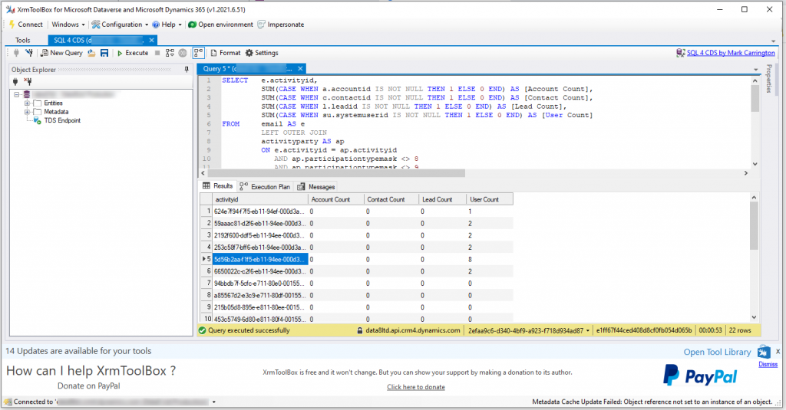

Recently I had an issue with Dataverse capacity and at the same time, I knew of at least 2 of my clients who also had a Dataverse capacity problem and the one thing we all had in common – activities where the biggest space taker! At face value it seems people track emails for all sort of reasons and often without thinking and if you’ve got auto tracking turned on, this becomes even more of a problem! So I took a look at our system and found some useful things out.

Emails are can be linked to all sorts – but for me, I always want them to be against a “person” so this could be a lead, contact or account but I found I had lots of other examples and the 2 most common examples were either

-   Emails that were internal emails between system users only with no external contact
-   Emails that were just “there” and didn’t link to anything. You can see these by the email address being “red”.

So I decided to look further and see if I could get rid of these as they brought no business value and just took up valuable space and I came up with a criteria I thought I would share today, just in case it’s of any use to you too. Just to quantify, when I first ran it this saved around 20% capacity on the email table.

Sadly this criteria is too advanced to be parsed into simple FetchXml so it’s time to rely upon an incredible tool called SQL4CDS made by my friend, colleague & fellow MVP Mark Carrington – [details of which can be found here.](https://markcarrington.dev/sql-4-cds/) This tool ultimately let’s me write a SQL like statement and execute it against my Dataverse – including deletes if I wish!

My SQL4CDS statement looks like this:

<blockquote class="wp-block-quote is-layout-flow wp-block-quote-is-layout-flow">
<code>SELECT e.activityid, SUM(CASE WHEN a.accountid IS NOT NULL THEN 1 ELSE 0 END) AS [Account Count], SUM(CASE WHEN c.contactid IS NOT NULL THEN 1 ELSE 0 END) AS [Contact Count], SUM(CASE WHEN l.leadid IS NOT NULL THEN 1 ELSE 0 END) AS [Lead Count], SUM(CASE WHEN su.systemuserid IS NOT NULL THEN 1 ELSE 0 END) AS [User Count] FROM LoadEmailsOutput AS e LEFT OUTER JOIN LoadActivityPartiesOutput AS ap ON e.activityid = ap.activityid AND ap.participationtypemask &lt;&gt; 8 AND ap.participationtypemask &lt;&gt; 9 LEFT OUTER JOIN LoadAccountsOutput AS a ON a.accountid = ap.partyid LEFT OUTER JOIN LoadContactsOutput AS c ON c.contactid = ap.partyid LEFT OUTER JOIN LoadLeadsOutput AS l ON l.leadid = ap.partyid LEFT OUTER JOIN LoadSystemUsersOutput AS su ON su.systemuserid = ap.partyid WHERE e.regardingobjectid IS NULL GROUP BY e.activityid HAVING SUM(CASE WHEN a.accountid IS NOT NULL THEN 1 ELSE 0 END) = 0 AND SUM(CASE WHEN c.contactid IS NOT NULL THEN 1 ELSE 0 END) = 0 AND SUM(CASE WHEN l.leadid IS NOT NULL THEN 1 ELSE 0 END) = 0</code>

<cite>Example SQL script</cite></blockquote>

What’s it’s basically doing is looking at anything in any activity party field EXCEPT regarding and owner and counting the type of lookup it contains. If my email contains NO lookups to any account, contact or lead then as far as I’m concerned for my business, it’s rubbish and isn’t needed so I can delete it.

<figcaption>SQL4CDS</figcaption>

NOTE: This isn’t suitable for everyone and I am NOT advising you delete these. I’m offering this as a tip which may, or may not benefit you. Please use due diligence.
