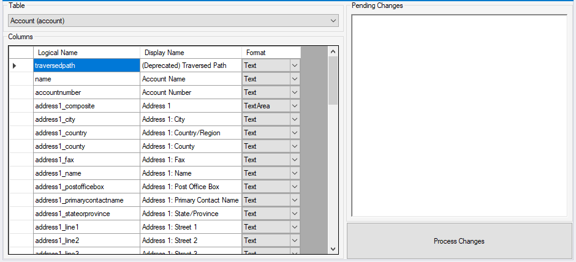
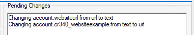

A very recent blog post and update came out from Microsoft which revealed you can now do something I know some people have wanted to do for the longest time – change the format of a field. Historically if you make a field a “Phone Number” or an “Email” then you’ve always been stuck with it in that same format which I’ve seen cause problems for people when they realise they were wrong.

Now, you can change that through the Dataverse API which you can read more about here: [https://docs.microsoft.com/en-us/powerapps/developer/data-platform/data-type-format-conversions](https://docs.microsoft.com/en-us/powerapps/developer/data-platform/data-type-format-conversions)

However… no-one wants to write bespoke code for little things like this and right now the User Interface of the maker portal still shows as ready only so I introduce to you my latest XrmToolBox tool – the Dataverse Format Changer.

<figcaption>Header tile of the tool</figcaption>

This tool does exactly what it says on the tin – allows you to select a number of columns in your table, change their formats and commit that to your Dataverse environment with a few clicks.

<figcaption>Screenshot of the tool</figcaption>

Firstly, you start by selecting the table you wish to edit in the top left which should populate the list of columns that are changeable. At the time of launch I’ve only included String and Memo but I will add the number/datetime ones in the coming days.

You can make the change using the drop down (thanks [@Mark Carrington](https://markcarrington.dev/)) which should show your request queued in the top right.

<figcaption>Example of queued changes</figcaption>

Once all your requests are queued, simply “Process Changes”. You’ll get an alert when all the changes have been processed – and if an error occurs it will also alert you of that too.

I know you’re going to try and change something to JSON so I can warn you now, if you do and it’s a relational table, it will error!

I’d love to hear your feedback on the tool. It is [Open Source](https://github.com/mattybeard/XrmToolBox_DataverseFormatChanger) and you can reach me on [Twitter](https://twitter.com/mattybeard) or [LinkedIn.](https://www.linkedin.com/in/mattbeard7/)

Finally, big thank you to [Mark Carrington](https://markcarrington.dev/), [Carl Cookson](https://linked365.blog/) and [Tanguy Touzard](https://twitter.com/tanguytouzard) for your support during this development.
