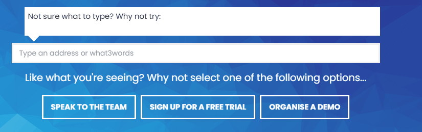
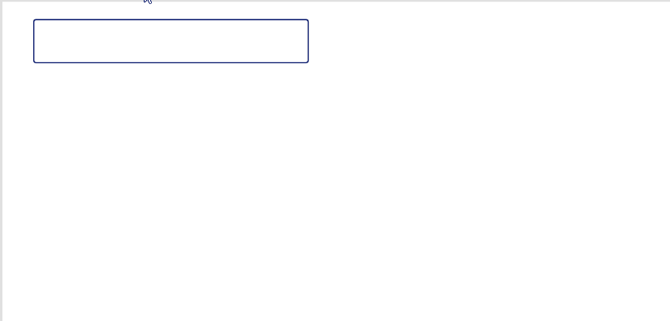
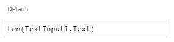
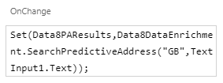
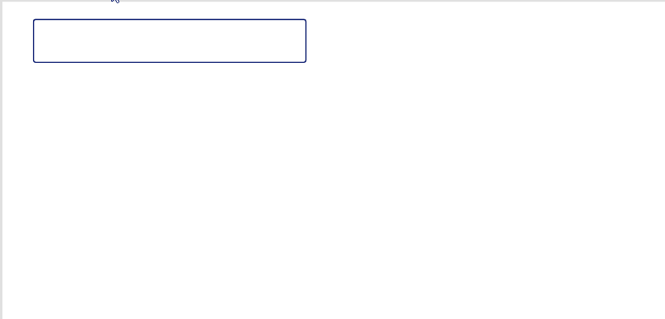

I was recently in contact with [Damien Bird](https://twitter.com/DamoBird365) – check out his [website](https://www.damobird365.com/) for great content and some fascinating stories – via Data8 and we were talking about a requirement for addressing software in Power Apps with a focus around OnKeyPress for the best possible user experience.

Data8 own a core API called “PredictiveAddress” which allows exactly that – addressing results based on any input. Data8 have a number of pre-built integrations across most platforms including Dataverse/Dynamics 365 model driven apps but one they don’t have is Canvas Apps because there is no native OnKeyPress event within Power App so one was never built – but after conversations with Damien and also with some fantastic support from newly minted MVP and future tennis #1 [Paul Murana](https://twitter.com/Paulie_m) – check out his [blog here](https://www.tachytelic.net/) – a way to implement OnKeyPress was found and I thought I’d share here.

## The Goal

Ultimately a responsive OnKeyPress event to run code each time a button is pressed. You can see on this image here a web based implementation of PredictiveAddress – this is functionality we would like to replicate in a canvas app.

<figcaption>A demonstration of a predictive address implementation.</figcaption>

## The Problem

Even though we have the data available to us through the Data8 connector (soon to be rolled out worldwide), an input box within canvas apps only has an OnChange event – which only fires when you move off the input box, rather than each time a button is pressed which doesn’t make for a great user experience. You can see an example of the issue here:

<figcaption>A demonstration of OnChange working</figcaption>

It still works but it doesn’t feel as intuitive as it probably should.

## The Fix

Firstly and most importantly, I take no credit for this solution – this is all from the amazing mind of Paul Murana!

There is no way of making a new event in canvas apps but we can use other elements cleverly to make it seem like we can – what I mean by that in this case, is a slider…

The workaround that was implemented was using the OnChange event of a slider that has a clever value set. By setting the default value of the slider to be the length of the input text, it forces it’s OnChange to fire each time a new button is pressed.

<figcaption>Using the slider as the OnChange trigger</figcaption>

This allows us to move the logic out of the OnChange on the TextInput and move it to the OnChange of the slider. Ultimately they are going to populate the same variable so it doesn’t really matter.

<figcaption>Setting the OnChange of the slider</figcaption>

And that’s with – we now have an OnKeyPress event that can make a more better, intuitive UI. I’m sure there are lots of use cases for this and here I’ve provided a real world one.

<figcaption>OnKeyPress working with addresses</figcaption>

Thank you for taking the time to read and please *[reach out](https://twitter.com/mattybeard)* if you have other use cases for OnKeyPress, I really do love to hear about clever use cases for things like this!

Finally, big thanks to Damien and Paul for all their input and knowledge. If you like to know more about the Data8 service too, [they’d love to hear from you.](https://www.data-8.co.uk/)
