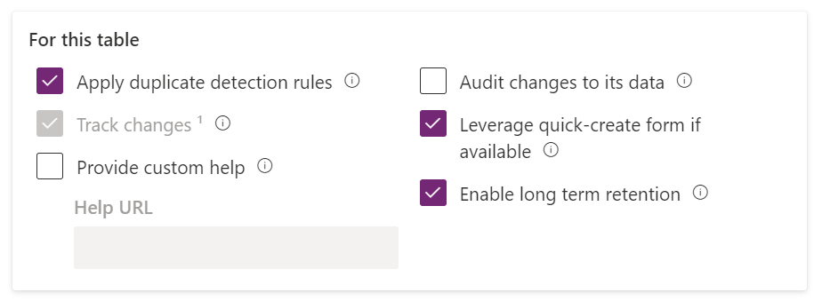
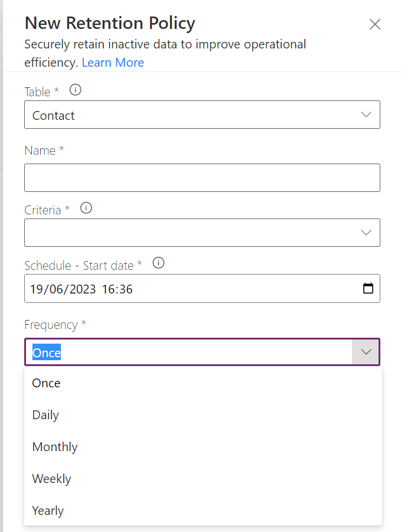
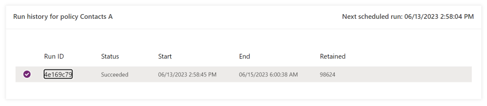
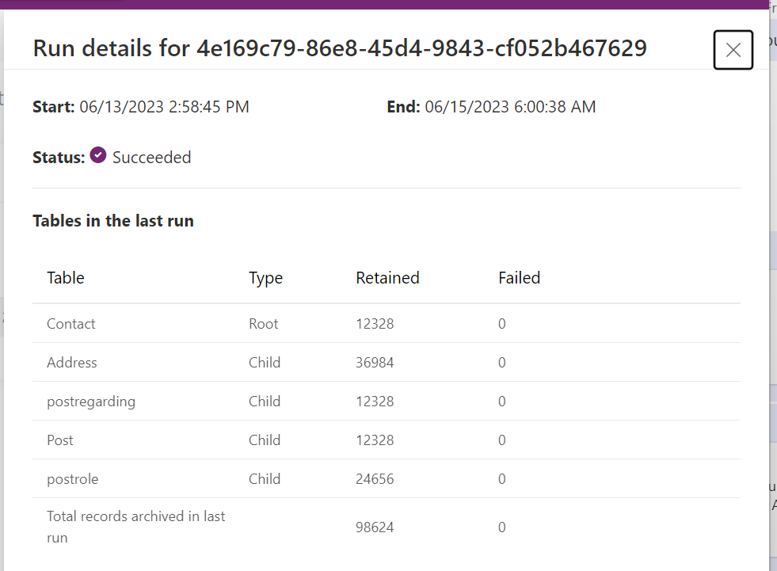
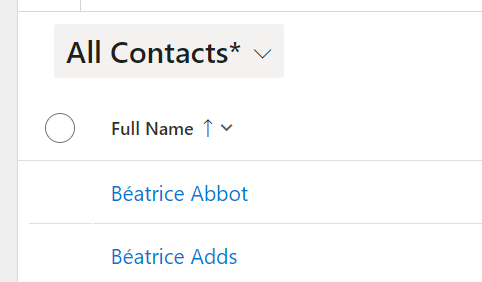
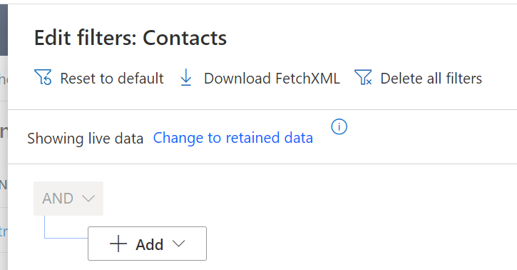
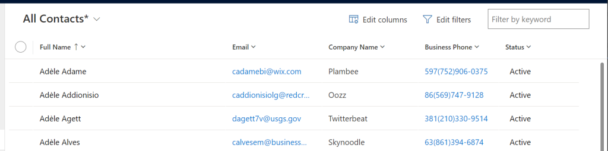
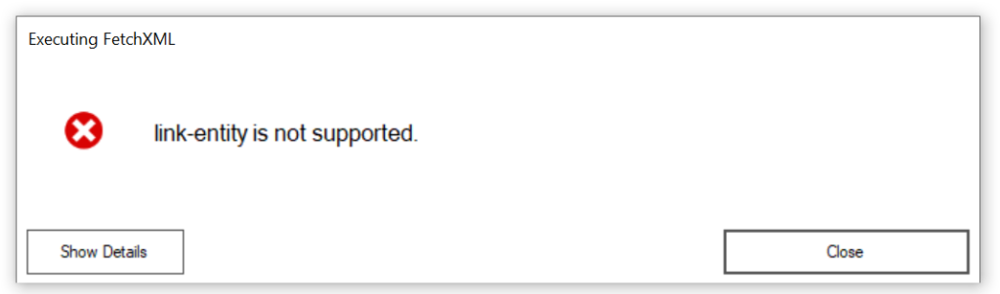
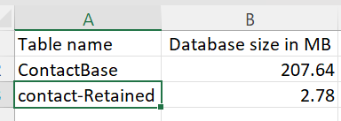

The feature formerly known as “Archival” has a new name – long term data retention and this long awaited feature is now available as a public preview in Sandbox environments so I’ve taken the opportunity to spin up a new environment and dive into this feature to see how it works, the benefits, the cons and all the in betweens.

The feature and all it’s documentation can be found here: [Dataverse long term data retention](https://learn.microsoft.com/en-us/power-apps/maker/data-platform/data-retention-overview) however as I work through it, I’ll point out the specific parts I’ve done here. Everything written is correct at the time of publish – but this is a preview feature which I expect to change a lot over time!

## What is it?

Good question Matt. Dataverse storage has long been an issue, exacerbated somewhat by the fact that most of the Microsoft first party applications eat up that same space – meaning you pay for everything and space is a real commodity. Knowing this, some people make the difficult decision to delete data that in a perfect world they would keep to stay within their allowance.

Long term data retention is an attempt to counter this and it introduces the option move that data to a different data source – in this case a data lake. The data isn’t deleted but it has new limitations and this post will go into some of these differences that what it all means.

## How to enable it?

Right now this is a little buggy, it certainly was for me – but again, preview disclaimer so I can’t complain. Retention is a solution aware setting you turn on at a table level so if we head to [https://make.powerapps.com](https://make.powerapps.com/) and browse to the table we want to retain and view it’s properties.

Here we see a new option – “Enable long term retention”. Check this and save the table settings. Now we wait – lots of clever things are happening here. It’s worth mentioning at this point that retention is treated very similar to a merge or a delete with regards to cascading – so even though you’ve only allowed retention on “contact”, this will actually be enabling it on anything else that would be affected by a cascade such as all the activity types and a bunch of other tables.

That’s it, retention is enabled and a few options have now been added to this table which we’ll go through – but first, let’s retain some data.

## Setting up a retention policy

The retention policy is the criteria in which to retain data. Eventually it will be visible on the left navigation bar for everyone but for now we have to add a secret code to our url to view it.

<pre><code>?retentionPolicies.registration=true&amp;retentionPolicies.leftNavigation=true</code></pre>

This will get you into the Retention Policy part of the maker portal – open up the option to make a new retention policy.

Here you specify the table, give it a name (this is for your reference only), a saved system view and determine the schedule. This could be a one off like I’ve done for my testing or it could be a scheduled run – perhaps archiving contacts where modified on > 5 years old and run it on a schedule? Anything you can build in a view you can use here – although it’s a little annoying that it has to be a system view to be used here as once the retention policy has ran the system view should always return 0 records.

This will run as soon as your start date is triggered, or now if it was in the past. If you open the retention policy, you can see all it’s previous runs. In my entirely unpractical initial test run, I archived all contacts whose first name started with “a” – real world scenario right there…

Took me a short while to realise this but the Run ID is clickable for a little more information, including counts.

That screenshot shows the cascade kicking in too that I mentioned early. One thing to note here is timing – official stance is the retention policy is low priority for the Dataverse platform and will take between 24-72 hours to run and in my testing, this is generally true although it’s always been nearer the 72 hour mark rather than the 24 hour mark.

## What does it look like on the front end?

Enough configuration, what does it actually look like on the front end is what everyone is asking so let’s take a look. As I mentioned, my criteria was name started with an a – so let’s look at “All Contacts” in the same order.

Don’t worry about GDPR at this point by the way, I use the [Mockaroo Data Munger](https://www.xrmtoolbox.com/plugins/LinkeD365.MockarooDataMunger/) by the amazing [Carl Cookson](https://twitter.com/LinkeD365) to make 100,000 fake contacts in my system so none of this data is real but it is of a nice volume.

It starts with B! All my A records are gone and not visible, not even in “All Contacts”, so where are they? They are retained in the data lake and from this point, we need to treat our contacts essentially as two separate tables – contacts and retained contacts – these two things can no longer be viewed together in the platform.

Open the new filtering functionality (no more opening the old Advanced Find) and you should see a new option saying “Change to retained data”.

This is how we determine which type of contacts we are now looking at. By changing to retained, you still get the same filter builder UI so let’s build a criteria and see what the results look like. One thing you’ll quickly notice, it’s nowhere near as quick to render the results – this is hardly surprising considering the extra heavy lifting it’s doing what I guess to be some clever Serverless SQL.

There are my A’s! Rendering in the view I specified and I can edit my columns accordingly – although note the company name column, it’s no longer a clickable lookup. Relationships are a going to be a little weird on the UI, although they still stored in the data lake as GUIDs so I’m unsure why they aren’t clickable links right now.

Another thing you’ll notice – you can’t click through the row to see the main form. So right now, this is all your getting. My main question was always how would they render the form and make it read only or not – the answer is simply that you cannot view the form at all. Looking at is in a grid is all we get!

## How did that work?

The magic here is all in that extra click of “Change to retained data” and how it’s setting a property on your FetchXML – it’s setting a “datasource” property at the root of the fetch.

Using [Jonas](https://jonasr.app/)‘ [FetchXMLBuilder](https://fetchxmlbuilder.com/), this is our FetchXML we are running – note the top line:

<pre><code>&lt;fetch datasource="archive"&gt;
  &lt;entity name="contact"&gt;
    &lt;attribute name="contactid" /&gt;
    &lt;attribute name="parentcustomerid" /&gt;
  &lt;/entity&gt;
&lt;/fetch&gt;</code></pre>

Other than that, it’s all the same! Very clever but there are some limitations.

Anything outside of getting a column on the flat retained table is unsupported. No link entities for advanced filtering, no aggregation. I understand why, Serverless SQL is basically magic, but it’s still a little sad to see.

It’s also interesting to see we can do this in C# QueryExpression too according to this [documentation](https://learn.microsoft.com/en-us/power-apps/developer/data-platform/webapi/reference/queryexpression?view=dataverse-latest). The “datasource” property has been added there too and should be set to “archive” although I assume the limiations are the same (I haven’t tested that).

## What about my storage?

I guess that was the main point wasn’t it – so what has this done for my storage. I waited 24 hours for the Power Platform Admin Center to update then I downloaded all my table sizes to take a look. I now have two entries for contact – contactBase and contact-Retained.

This is where it gets a little more interesting, as I need to know the counts to see what that means. I moved 12,329 records to the data lake through my retention policy meaning each contact in my data lake is taking up 225 bytes of data.

I have 87,672 contacts still stored in Dataverse, which works out at 2368 bytes per contact – so contact for contact, my data lake store is using 10% of Dataverse. A significant space is saved there!

At this time, we have no idea at all what this is going to cost, you’d hope data lake storage is cheaper than Dataverse storage but we really have no idea – but even still, if my contains are only counting as 10% towards my Database storage then it’s still a significant saving regardless.

## In Summary

When asked “Is it worth it?” then my answer is the usual answer – it depends.

If keeping cost down is your main priority, you may prefer that and to lose some functionality but if keeping the functionality and all the links is the most important, then this isn’t for you.

It’s interesting seeing retention being exposed and supported in C# and FetchXML – who know’s what XrmToolBox tools we’ll see coming out in the future…

Would love to hear your thoughts on Dataverse long term retention, please reach out on [LinkedIn](https://www.linkedin.com/in/mattbeard7/), [Twitter](https://twitter.com/mattybeard) or on this post if you have any question and I’ll do my best to answer them.
