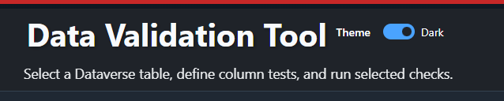
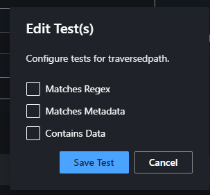
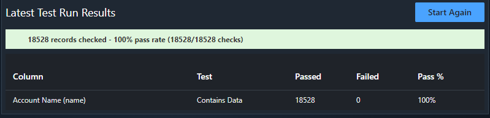

Back in 2020, I released my Data Validation Tool for Dataverse in XrmToolBox.

The thinking behind it was simple enough. I wanted an easy way to run checks against Dataverse data in bulk and get a quick feel for how good the data actually was. Not how good people thought it was, or how good the schema suggested it should be, but what was really sat in the table.

Six years later, I’ve now released an updated version of the tool for Power Platform ToolBox.

The idea has not really changed. It is still about helping you inspect data quickly, run a few useful tests, and spot problems without having to mess about exporting everything and picking through it manually.

## What it does

The tool lets you connect to Dataverse, choose a table, pick the columns you care about, and assign one or more tests to those columns.

Once you run it, it will pull back the data and show you how it performed. You get an overall pass rate, plus a breakdown by column and by test, so you can see where things are going wrong.

That makes it useful when you have inherited an environment, taken on a new customer, imported data from somewhere else, or just want to sanity check a table that looks a bit suspect.

## The kinds of checks it supports

At the moment, the tool focuses on a few straightforward checks.

### Contains Data

This does exactly what it says. It checks whether the field actually contains a value.

That sounds basic, but it is usually one of the first things worth checking. Plenty of fields look important on paper and turn out to be mostly empty once you actually inspect the data.

### Matches Regex

This allows you to apply a regex pattern and check whether the value matches it.

Useful for things like email addresses, phone numbers, postcodes, references, account numbers, or anything else where you are expecting a certain structure.

It is not perfect, and it is not pretending to be. Regex is a quick way of finding obvious issues, not a replacement for proper validation services. Still, it is a handy test to have when you are trying to get a feel for the state of a dataset.

### Matches Metadata

This one checks whether the data matches what Dataverse says the field should contain.

So that might mean checking:

-   text length
-   minimum and maximum numeric values
-   valid choice values
-   valid status or state values

You could argue Dataverse should already enforce this, so why bother checking it.

In reality, data gets into systems in all sorts of ways. Imports, integrations, old processes, dodgy scripts, historical records. Just because the metadata says one thing does not mean the actual data is as clean as you would hope.

## Why I find this useful

Because data quality issues are usually boring.

They are not dramatic. They do not always throw errors. They do not usually stop a solution from working. They just quietly sit there and make everything a bit worse.

Reports become less reliable. Automations behave strangely. Users stop trusting what they see. Integrations need extra handling. Then before long you are spending more time working around the data than actually building anything useful.

This tool is not trying to solve all of that on its own. It is just a practical way of taking a look at a table and seeing how healthy the data really is.

For me, that is often the useful bit. Not a huge cleansing exercise. Just a quick, repeatable way to inspect what is there and spot the worst offenders.

## Why bring it back now?

Mostly because the need for it has not gone away.

If anything, it matters more now. More people are building on top of Dataverse data than ever before. Power Automate, reporting, integrations, Copilot, custom apps, all of it depends on the data underneath being at least vaguely trustworthy.

And that is usually the problem. Everyone wants to build on the data, but not many people stop to check what state it is actually in first.

So this is really just me bringing the same idea forward into a newer toolset.

## Final thoughts

This is a simple tool. That is the point.

It is there to help you inspect data, run a few useful checks, and get some proper visibility of what is in your tables. Nothing more complicated than that.

Sometimes that is all you need to get started.

The project is here if you want to take a look:

-   GitHub: [https://github.com/mattybeard/PPTB\_DataValidation](https://github.com/mattybeard/PPTB_DataValidation?utm_source=chatgpt.com)
-   Power Platform ToolBox: [https://www.powerplatformtoolbox.com/tools/b043a893-6a6d-4a23-93e4-97cc223f6a9b](https://www.powerplatformtoolbox.com/tools/b043a893-6a6d-4a23-93e4-97cc223f6a9b?utm_source=chatgpt.com)
