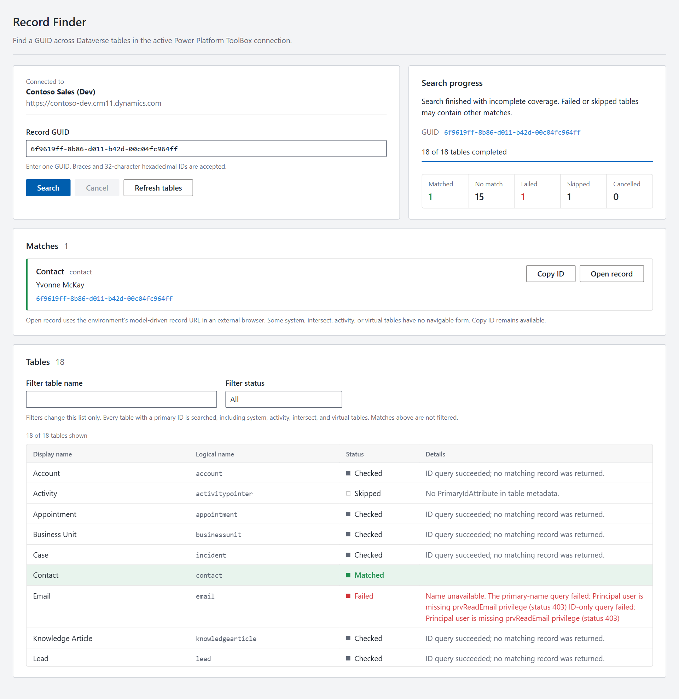

## A note before the draft

The post below was drafted and ready to publish before I learned, during the approval process, that a tool already existed which does more and does it better. I should have researched what was already available before I started building.

The GitHub repository is now archived. I'm still publishing this post as a reminder that we can all make mistakes, rush into things and learn from them.

## The PPTB Record Finder

Sometimes a log gives you useful context. At other times, a client sends you a GUID and not much else. You have an ID to investigate, but you don't know which table it belongs to.

I've needed to find a record from a GUID before, and I needed to do it again today. So I've built Record Finder, a small tool for [Power Platform ToolBox](https://powerplatformtoolbox.com/) that does the table checking for me.

## What Record Finder does

Give Record Finder one GUID and it checks the tables in your active Dataverse connection for a record with that primary ID. It uses each table's actual primary ID column, rather than assuming they all have the same name.

It attempts every table with a primary ID, including system, activity, intersect and virtual tables. It keeps looking after a match, so you can see if the same ID exists in more than one table. Tables without a primary ID are skipped.

The search is read-only. It looks for the GUID as a record's primary ID, not in every GUID-valued column. For example, it won't find a GUID that only appears in a lookup.

Tables are checked one at a time, and the progress list shows which ones matched, were checked without a match, failed or were skipped. You can also cancel a search and keep the results from completed tables.

## Using the tool

1. Open Record Finder in Power Platform ToolBox and select a Dataverse connection.
2. Wait for the table metadata to load.
3. Enter one GUID and select **Search**.
4. Review the matches and table statuses. Use **Copy ID** or **Open record** on a match.

You can enter a hyphenated GUID, a GUID in braces, or 32 hexadecimal characters. Paste the GUID itself rather than a URL containing it.

For each match, the tool shows the table and, when available, the record's primary name. **Open record** tries to open its model-driven record URL in a browser. Some tables don't have a navigable form, so that link may not work even when the search found a match.

## What a search result tells you

Record Finder uses the permissions of your current connection, so it can only return records your account can access. No match does not necessarily mean a record is absent. It might not be visible to you.

It's also worth checking for failed or skipped tables. If a table fails, is skipped or has not been checked because you cancelled the search, the tool cannot tell you whether it contains a match. The status list shows where that happened.

## Get Record Finder

The source and instructions are on [GitHub](https://github.com/mattybeard/PPTB_RecordFinder).
